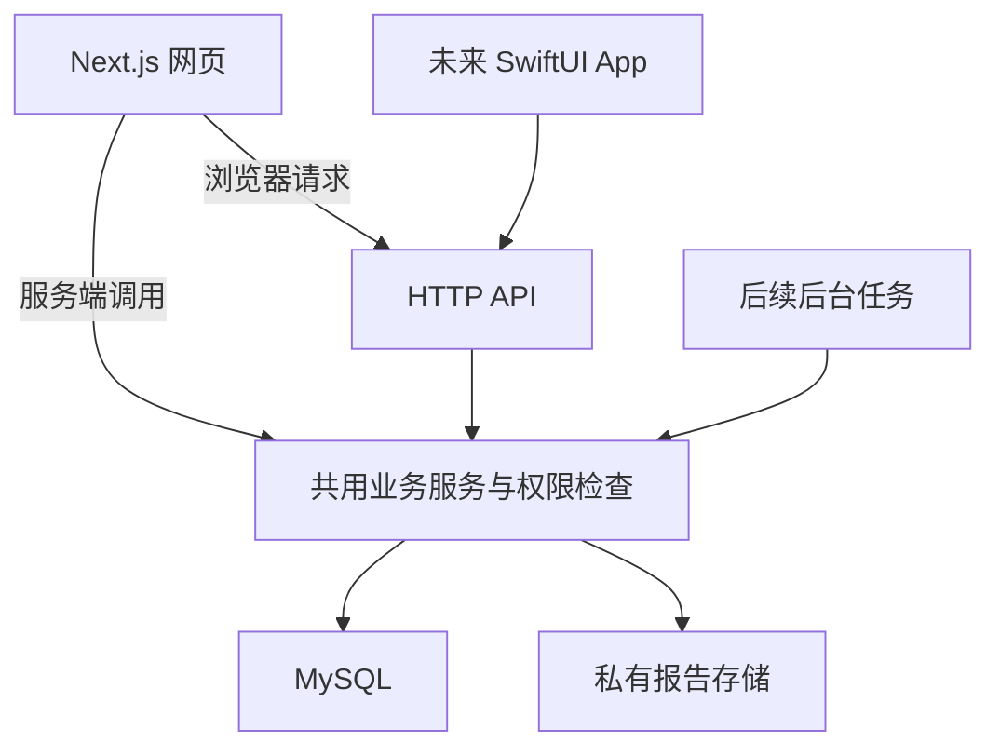

# BodyTrace Next.js 开发文档

版本 1.1 · MySQL + Drizzle 方案 · 更新日期 2026 年 10 月 12 日 · 适用对象 丹青及协作开发工具

**当前仓库基线**：已从 PostgreSQL 切换到 MySQL，继续使用现有 Drizzle ORM、mysql2 和 npm。保留现有食物库、饮食快照、饮食计划、资料及认证功能；身体变化已支持体重、体脂率和血压的持续记录、趋势与历史维护，报告和统一时间线仍是后续产品目标。应用表使用 `bodytrace_` 前缀，与云库已有表共存；旧 PostgreSQL 迁移留作存档，MySQL 迁移单独位于 `drizzle/mysql/`。切换连接不会自动搬运旧 PostgreSQL 数据。

BodyTrace 先以 Next.js 网页端验证个人身体档案的使用价值，同时建设未来 iOS 可以调用的 HTTP API。核心流程稳定后，使用 Swift 与 SwiftUI 开发苹果客户端，继续使用已有账户、业务服务和数据。饮食与健身是日常入口，长期目标是让个人身体资料能够持续积累、方便找回，并支撑有来源的个人助手。

当前推荐采用一个 Next.js 项目、你现有的 MySQL 和一套私有报告文件存储。业务规则集中在服务层；网页服务端与 HTTP API 共同调用。第一版以记录、整理、计划执行和回看为主。AI 首先作为开发工具使用，产品内的 OCR 与个人助手按阶段加入。

**先执行的决定**：Next.js 16 稳定分支、Node.js 24 LTS（`.nvmrc` 与 `engines` 固定主版本）、TypeScript strict、现有 MySQL、Drizzle ORM 与 mysql2、Better Auth、Tailwind CSS 4 与 shadcn/ui。生产依赖采用经过验证的兼容版本并提交 package-lock.json。云 MySQL 已核对为 8.0.36；版本维护、生产权限、部署地域、首批用户来源和经营主体仍需在接收真实用户健康资料之前确定。[S01][S02][S03][S04][S07][S36]

**阅读顺序**：先看第 1 至 3 章确定范围和选型；按第 4 至 9 章实施；第 10 至 13 章用于上线与后续扩展；第 14 至 16 章确定发展顺序、验收和 AI 协作方式。附录保留官方资料入口。文中的人数、配额和恢复目标属于本项目建议，须通过实际使用与演练调整。

## 1 产品目标与首版范围

### 1.1 已经确定的方向

网页先行，网页与后端一起开发；后续客户端仅考虑苹果生态。沿用现有 MySQL，在当前仓库上增量开发，先复用已有功能与服务层。开发投入以个人维护能力为约束，优先让完整流程投入实际使用。

首版建议面向成年人管理本人的资料。家庭档案、未成年人、医生协作、诊疗服务和机构管理会增加独立的权限与业务要求，进入后续需求评估。数据库保留资料主体标识，但初期界面只提供本人档案。

首批用户的工作假设是有体重管理需求、愿意记录饮食或训练、手里已有体检报告的人。该假设需要访谈验证，不能据此声称市场已经成立。生产服务的主要地区尚未确定，不能把“只做苹果客户端”等同于“只服务海外用户”。

### 1.2 第一版应完成的用户任务

用户建立身体档案，安排一周饮食目标，记录体重、饮食与训练摘要，导入一份报告，然后在时间线上回看这些记录。首次使用时应尽快出现一条真实记录和一次可理解的回看，减少必须先填写的大量资料。

| 能力 | 首版交付 | 后续增强 |
| --- | --- | --- |
| 身体档案 | 基础资料、目标、单位和时区 | 家庭档案、更多来源与设备 |
| 身体指标 | 体重等少量明确指标的记录与修正 | HealthKit 接入、更多趋势 |
| 饮食计划 | 逐天目标 + 早/午/晚三餐食物（已实现；无版本模型） | 计划版本与历史回看、模板与食谱安排 |
| 饮食与训练记录 | 快速摘要、实际记录、完成情况 | 食品库、组数、设备自动导入 |
| 报告 | 原件、日期、分类、资料所属人 | OCR、人工确认、同项指标比较 |
| 时间线 | 统一展示真实事件和原件入口 | 周回看、筛选、阶段摘要 |
| 数据管理 | 导出、删除、授权管理 | 更完整的数据迁移与共享 |

首版的成果应当能回答“这一段时间，我执行了什么计划、记录了什么、有哪些身体资料”，并能回到原始记录。某类饮食模板的存在不代表它适合所有用户，产品初期不自动给出医学适用性判断。

## 2 默认技术选型

### 2.1 主技术栈

| 层次 | 默认选择 | 用途与边界 |
| --- | --- | --- |
| 运行时 | Node.js 24 LTS（≥24.22.1） | 由 `.nvmrc` 与 `engines` 固定；开发、CI、生产保持同一主版本，服务器构建产物不跨平台复制 |
| 应用框架 | Next.js 16 稳定分支与 App Router | 网页、服务端渲染、HTTP 接口 |
| 语言 | TypeScript strict | 核心逻辑与契约避免隐式 any |
| 包管理 | npm 与 package-lock.json | CI 使用 npm ci，保持依赖版本一致 |
| 数据库 | 现有 MySQL，业务表采用 InnoDB | 档案、计划、记录、权限、报告元数据；先核对实际版本 |
| ORM | Drizzle ORM 与 mysql2 | MySQL 表定义、查询、事务及版本化迁移 |
| 认证 | Better Auth | 网页会话与统一用户体系 |
| 界面 | Tailwind CSS 4 与 shadcn/ui | 可定制组件、统一设计变量 |
| 复杂表单 | React Hook Form 与 Zod 4 | 输入体验与客户端校验；服务端再次校验 |
| 客户端服务端状态 | 按需增加 TanStack Query | 分页、上传状态轮询、局部刷新 |
| 图表 | 优先使用 shadcn 图表方案的兼容依赖 | 少量趋势图，保留文本和表格替代展示 |
| 文件 | 私有对象存储 | 原件直传、授权读取、独立备份 |
| 测试 | Vitest 与 Playwright | 业务规则、接口权限与关键用户流程 |
| 持续交付 | Git 与仓库 CI | lint、类型检查、测试、构建与迁移检查 |

Next.js 官方支持表当前列出 16.x 为 Active LTS；Node.js 官方列出 24 为 LTS、26 为 Current。因此新项目默认采用 16 与 24 的组合，而不使用 Next.js canary 或仅满足最低要求但已结束维护的运行时。React 与 React DOM 使用当前 Next.js 稳定脚手架要求的兼容组合，不自行混搭预发布版本。[S01][S02][S03]

本项目沿用 Drizzle，以 `drizzle-orm/mysql-core` 定义表，使用 `drizzle-orm/mysql2` 和 mysql2 连接池。MySQL 不支持 PostgreSQL 的 RETURNING，写入后需要在事务中读取结果；upsert 使用 onDuplicateKeyUpdate。UUID 由应用生成，DATE 保持日期字符串，DATETIME(3) 及连接会话统一为 UTC。维护工具使用同一连接配置。[S04][S05][S36]

shadcn/ui 将组件代码交给项目维护，便于定制，也意味着加入项目后仍需跟进组件问题。Zod 4 已稳定；表单解析器应选择与 Zod 4 相容的版本。客户端校验帮助用户输入，服务端校验决定请求是否可被接受。TanStack Query 在出现明确的客户端异步状态需求时引入。[S11][S12][S13][S14][S15]

### 2.2 框架成熟度如何判断

选择框架时检查正式文档、维护状态、版本支持、迁移方式、与项目运行时的兼容性，以及发生问题时能否定位和替换。GitHub 星数和模板功能数量可以作为线索，不能代替这些判断。

| 决策 | 本项目默认 | 何时替换或增加 |
| --- | --- | --- |
| 基础脚手架 | 官方 create-next-app | 只有明确缺少的能力才增加模板 |
| Prisma 与 Drizzle | 沿用已安装的 Drizzle | 只有明确收益且另行制定迁移方案时再评估更换 ORM |
| Better Auth 与 Supabase Auth | Better Auth 接现有 MySQL | 以后整体改变托管方案时再评估 Supabase Auth |
| Auth.js | 新项目不作为默认 | 已有稳定 Auth.js 项目可继续维护，不必因本文件而重写 |
| REST 与 tRPC | HTTP JSON 与版本化契约 | 确定还存在另一类需求时再评估额外调用层 |
| 状态库 | React state、URL、服务端数据读取 | 出现清晰的跨页面客户端状态问题后再增加 |
| 独立后端框架 | Next.js 内的业务模块 | 独立部署、团队边界或运行需求出现后再拆分 |
| 队列 | 首版保留处理状态 | OCR、长时间导出或 AI 批处理出现时再加 |
| 向量库 | 首版使用结构化查询与普通检索 | 原报告文本检索的效果确实不足后再评估 |

Drizzle 官方提供接近 SQL 的查询方式、关系查询和迁移能力，是可用替代方案；当前不在本文件中假定其 v1 已正式稳定。[S06]

Auth.js 官方迁移指南已推荐新项目使用 Better Auth，同时说明已有 Auth.js 项目仍有安全与关键问题维护。当前采用 Better Auth 接现有 MySQL。Supabase Auth 属于另一个托管选择，不作为这条路线的必需服务，也不同时维护两套用户身份。[S09][S10][S37]

一体化 SaaS 模板可以加快熟悉的通用页面开发，但购买前应检查授权、实际依赖版本、认证可替换性、移动端 API、数据导出、生产密钥管理和后续维护。初期的身体档案业务仍需自行设计，模板不能替代这部分工作。

### 2.3 现有 MySQL 的接入检查

先核对版本、可用 database、账号权限、字符集、连接上限、部署位置和备份。以下为只读检查示例；文档没有连接或修改你的数据库。

```sql
SELECT VERSION();
SELECT @@character_set_server, @@collation_server, @@time_zone;
SHOW GRANTS FOR CURRENT_USER();
```

现有版本先做连接与迁移验证。需要新建或升级时选择服务商持续维护的 LTS 路线，并核对驱动兼容。MySQL 官方当前列有 8.4 与 9.7 LTS；8.0 自 2026 年 4 月 21 日进入 Oracle Sustaining Support。ORM 能连接某个旧版本，并不代表该版本仍有适合本项目的长期维护保障；升级单独安排，不在唯一真实库上直接试验。[S38][S39]

Better Auth 使用 Drizzle 适配器，provider 为 mysql，认证表与业务表放在同一环境的数据库中。schema 显式映射 user、session、account、verification 到 `bodytrace_` 表；认证模型的后续变化统一生成 Drizzle 迁移。[S37][S40]

开发时用 `npm run db:generate` 生成并审查迁移，再在独立测试库运行 `npm run db:migrate`；生产也应用同一组迁移。`db:push` 仅用于可以重建的开发库，不直接推进云生产库。已有业务表先备份并建立基线，不执行 reset、强制覆盖或无条件清空。Drizzle 不要求 Prisma 的 shadow database。[S41]

## 3 应用架构与代码组织

### 3.1 一个项目内保持清楚边界



Route Handler 负责 HTTP 参数、身份识别、输入校验、错误映射和响应；业务服务负责计划规则、资源归属、事务与状态变化；数据访问层负责具体查询和存储。服务接收明确的调用者上下文，不直接依赖 React 组件、浏览器状态或整份 Request 对象。

网页服务端组件可以直接调用同一业务服务，保留相同权限检查。浏览器交互和未来 iOS 通过 API 调用。Next.js 官方建议服务端组件直接获取数据，绕回请求自己的 Route Handler 会增加往返，并可能影响构建期执行。[S16]

Server Actions 可用于网页特定交互；核心业务仍有稳定 HTTP API。不要让饮食目标计算分别存在于页面、Server Action 和接口中。一个操作只有一份权威服务端规则。[S16]

### 3.2 建议目录与职责

| 路径 | 职责 |
| --- | --- |
| src/app | 页面、布局、网页入口 |
| src/app/api/v1 | BodyTrace 业务 HTTP API |
| src/app/api/auth | 认证库的路由入口 |
| src/modules/profile | 身体档案及资料所属人 |
| src/modules/measurements | 指标写入、修正与查询 |
| src/modules/plans | 计划模板、版本、日期目标 |
| src/modules/records | 饮食与训练实际记录 |
| src/modules/reports | 上传、原件、提取与确认 |
| src/modules/timeline | 聚合查询与回看 |
| src/server | 数据库、认证、文件存储与日志适配 |
| src/contracts | 输入 schema、响应 DTO、错误码 |
| src/components | 共享 UI 与业务展示组件 |
| src/db/schema.ts 与 drizzle/mysql | Drizzle MySQL 表定义与版本化迁移 |
| tests | 独立业务样例、接口与端到端验证 |
| docs | 接口契约、决定记录、开发任务与上线说明 |

上表的业务模块是后续职责划分；当前代码已有 `src/services`、`src/db` 和 `src/lib`，优先在已有结构中实现，不为了目录形式重写服务。只有在职责确实需要分开时才增加文件，不为简单查询生成一整套空壳层次。

## 4 数据模型与身体档案语义

### 4.1 核心实体

| 实体 | 主要职责 | 首版约束 |
| --- | --- | --- |
| User 与 Session | 登录身份和会话 | 采用认证库模型与迁移流程 |
| Subject 与 Profile | 资料属于谁、基础身体档案 | 一个用户仅管理本人 Subject |
| Measurement | 体重等身体指标观测 | 保存时间、单位、来源和版本 |
| PlanTemplate | 可复用计划结构 | 与用户执行历史分开 |
| PlanVersion 与 DailyTarget | 一段时间内的具体计划与每日目标 | 修改计划不改写过去目标 |
| DietRecord 与 TrainingRecord | 实际发生的饮食、训练记录 | 未记录与零值、未执行分别处理 |
| Report 与 ReportFile | 检查报告和不可变原件 | 日期、所有者、状态、文件校验 |
| ReportObservation | 从报告提取或确认的结果 | 原始值、结构化值、参考范围及原件位置 |
| ConsentRecord | 授权范围、版本与撤回状态 | 可回答何时同意了哪一项处理 |
| ProcessingJob | 后续 OCR 等任务的状态 | 有幂等键、处理版本与失败原因 |

时间线首先作为上述数据的聚合视图，不另建一份可以独立编辑的健康事实库。规模增大后可增加可重建的查询投影，避免两套事实不一致。订阅权益、分享授权和 AI 对话等表在对应能力进入开发时增加。

### 4.2 必须统一的数据约定

**身份与归属**：对外使用稳定、不包含个人信息的 ID。业务数据有 subjectId，查询和写入均通过已验证用户检查归属。未来共享权限可以扩展关系，但客户端传来的 ownerId 不能决定访问权。

**时间**：区分事件发生、检查采样、报告出具、上传和修改时间。事件时刻使用带时区信息的 ISO 8601 输入，数据库保存适合的时间类型；日计划额外保存 localDate 和 IANA 时区。仅知道日期时保留日期精度，不伪造上午零点作为实际采样时刻。

**单位与精度**：保留原单位。标准化值、换算规则和版本单独保存。对精度敏感的数值使用数据库 Decimal，API 以十进制字符串表达，并记录精度规则。体重、检验值、食物份量的格式分别校验，不使用一个没有类型约束的 value 包办所有含义。

**来源**：区分手动录入、用户自述、报告记载、设备数据和 AI 推断。未来 HealthKit 数据保留来源记录 ID。相同时间和相同数值并不证明是重复测量。

**缺失**：空值表示未知或未填写；0 表示真实零值。未记录的一餐不能自动计为零摄入，缺失的检验值不能在趋势图里画成 0。

**历史与修正**：计划历史保留快照或版本。指标修正保留必要的更改记录。删除标记可用于未来同步，但不等于已经永久删除；真正的数据删除还应覆盖原件、提取结果、索引和缓存。

### 4.3 报告结果不能只保存一个浮点数

检验结果可能是数值、低于某个检出限、区间、阴性或阳性，也可能是描述性文本。建议保留 rawValue，同时按类型存储 numericValue、comparator 或 textValue。原始单位、标本、检测方法与报告中的参考范围随结果保存。

识别出的指标采用 pending、confirmed、corrected 等确认状态，并关联原件页码或定位信息。相同中文名称未必足够证明指标可直接比较；缺少必要单位或检测背景时提示需要确认，保留原件入口。

首版先处理少数清楚定义的指标。通用医疗术语库和自动合并所有检验指标属于后续项目，不应成为首次上线条件。

### 4.4 MySQL 的实现约定

业务表采用 InnoDB，文本使用 utf8mb4。不同 MySQL 版本可用的排序规则可能不同，迁移以现有版本为准；用户输入和标识符的大小写比较规则要明确定义。[S42]

事件时刻建议转为 UTC 后存入 DATETIME(3)，驱动读写也按 UTC 处理；原 IANA 时区另存。DATETIME 本身不保存时区，不能仅凭这个字段还原用户当地日期。日计划与只知道日期的报告使用独立 DATE 语义，禁止因为转成 JavaScript Date 就让日期偏移。[S43]

数值列按业务定义 Decimal 的精度和范围；结构化核心字段独立建列，JSON 用于有版本的来源信息或扩展内容。PDF、图片和大附件保存在独立文件空间，MySQL 保存元数据与关联，避免把所有资料打包为一个难以查询的大 JSON。

饮食照片当前使用腾讯云 COS 的**公有读、私有写**桶：数据库 `bodytrace_meal_photo` 保存对象 key、尺寸和顺序，浏览器拿到的是带随机 UUID 的对象地址。这样实现简单、可直接使用 CDN，但公开地址一旦泄露就无法撤回，只能删除对象。因此对象 key 不包含用户 ID、邮箱或手机号，上传前统一去 EXIF/GPS，不开放桶内对象列举；删除照片会同时删除对象。更敏感的报告原件不应复用这个公开读桶，仍应使用私有读配置（`COS_PHOTO_ACCESS=signed` 只解决读取地址，不改变桶的 ACL）。

索引从真实查询开始，例如指标列表的 subjectId、type、occurredAt 与 id，以及计划的所属人和日期范围。幂等键采用对应用户与操作范围内的唯一约束。数据库约束配合事务实现规则，不能只靠前端先查询是否存在。

数据库调用运行在 Node.js 服务端。复用 Drizzle 与 mysql2 连接池，按实例连接上限分配应用、worker 和迁移连接，避免每个请求无界新建连接。当前应用池上限为 10；小规模先分析慢查询与索引，再决定是否需要缓存或拆分数据库。

## 5 HTTP API 与未来 App 契约

### 5.1 接口约定

业务接口使用 `/api/v1`；对外 JSON 使用 camelCase，身份从服务端验证的会话获得。以下为**当前已实现**的接口概览，完整参数、响应与错误行为统一以 [API 参考文档](BodyTrace_API_Reference.md) 为准。

| 接口 | 用途 | 重要约定 |
| --- | --- | --- |
| GET 与 POST /api/v1/foods | 食物库列表、搜索与新增 | 每 100g 营养、收藏筛选、按用户隔离 |
| PATCH 与 DELETE /api/v1/foods/{id} | 修改或删除食物 | 饮食历史快照不变 |
| GET /api/v1/foods/recents | 最近吃过的食物 | 全部记录先去重，再取最近 12 种 |
| GET /api/v1/foods/reference | 搜索共享参考库 | 需登录，只读，最多 20 条 |
| GET 与 POST /api/v1/meals | 按日查询与新增饮食记录 | 真实日历日期，新增不能为未来，营养快照 |
| PATCH 与 DELETE /api/v1/meals/{id} | 改克数或删除记录 | 用原记录快照缩放 |
| GET /api/v1/summary | 某天汇总 | 四餐、合计、当天生效目标 |
| GET /api/v1/trends | 营养趋势 | 7–180 天，非法参数回落 30 |
| GET 与 PUT /api/v1/goals | 每日目标 | 整体保存，返回 `{goals}` |
| GET、PUT 与 DELETE /api/v1/plan | 当前饮食计划 | 每用户一条，无历史版本；整体保存七天目标与食物项 |
| GET 与 PUT /api/v1/profile | 获取与保存本人资料 | PUT 必须提交性别、身高、目标体重，可用 null 表示未填 |
| GET 与 POST /api/v1/measurements | 查询与新增指标 | `range=7/30/90/all`，JSON 请求体 `requestId` 幂等 |
| GET、PATCH 与 DELETE /api/v1/measurements/{id} | 指标详情、修改与软删除 | 归属校验、`version` 冲突与幂等重试 |
| PATCH 与 DELETE /api/v1/meals/{id} | 改克数或删除记录 | 删除时级联照片行并清理 COS 对象 |
| GET、POST /api/v1/meals/{id}/photos | 核对上传结果、添加照片 | POST 为 multipart `file` + 可选 UUID `requestId`；同编号同文件返回原照片；最多 6 张、8 MB、服务端转 WebP 去 EXIF |
| DELETE /api/v1/meals/{id}/photos/{photoId} | 删除一条饮食记录的照片 | 校验记录归属与照片归属 |
| DELETE /api/v1/records | 一键清空本人饮食记录与身体指标 | 同一事务硬删除；食物库、目标、计划与资料不动；照片对象提交后清理 |

饮食记录的响应增加 `photos` 数组（没有照片时为 `[]`），元素含 `id`、`url`、`thumbUrl`、`width`、`height`、`position`；照片默认公开读，`COS_PHOTO_ACCESS=signed` 时返回短时签名地址。业务写入的预期错误为 `{error: "说明"}`，状态为 400、401、404 或 409；照片上传另外可能返回 413、502、503；同编号不同内容及已删除照片的重放返回 409。照片删除保留幂等标记，读取和数量上限只计算未删除行，清理脚本也只将有效照片视为对象引用。`/api/auth` 采用 Better Auth 自身的 `{code, message}` 和来源校验，不能套用业务接口的错误格式。逐步为新增接口定义明确 DTO；现有食物、饮食记录和参考库响应仍带代码实际返回的字段，不能仅改文档就删掉旧客户端依赖的字段。

以下接口仅为**后续路线图**，路径和字段尚未定稿，当前没有实现，不可直接调用：

| 规划接口 | 用途 | 待落实的约定 |
| --- | --- | --- |
| POST /api/v1/training-records | 新增训练摘要 | 实际发生时间 |
| POST /api/v1/uploads | 创建上传授权 | 文件配额与随机对象键 |
| POST /api/v1/uploads/{id}/complete | 确认上传完成 | 服务端核对真实对象 |
| GET /api/v1/reports/{id} | 查看报告元数据 | 按需生成授权文件入口 |
| POST /api/v1/reports/{id}/confirm | 确认识别结果 | 处理版本与人工修正 |
| GET /api/v1/timeline | 查询统一时间线 | 游标分页、过滤范围 |
| POST /api/v1/exports | 创建资料导出 | 核对归属，返回任务或结果 |

尚未上线的功能不提前生成空接口。饮食计划版本、历史目标、分页及来源扩展也属于后续任务，实施时另行设计迁移和兼容性；当前饮食记录使用 `/meals`、计划使用单数 `/plan`，不另行引入 `/diet-records` 或 `/plans` 平行契约。

### 5.2 当前指标接口的示例

以下内容为虚构测试数据，不代表用户本人的身体情况。

```http
POST /api/v1/measurements
Content-Type: application/json
Authorization: Bearer <session-token>
```

```json
{
  "requestId": "7f3a9c1e-3333-4d8a-b6f5-9e8d7c6b5a4f",
  "measurement": {
    "kind": "weight",
    "date": "2026-10-12",
    "time": "14:30",
    "value": "86.4",
    "note": null
  }
}
```

`requestId` 是 JSON 必填字段，不读取 `Idempotency-Key` 头。`kind` 为 `weight`、`bodyFat` 或 `bloodPressure`；体重与体脂率使用十进制字符串，单位由类型决定。日期和可选时间表达用户填写的测量时间，时区由服务端 `APP_TIMEZONE` 设置，客户端不提交 `type`、`unit`、`occurredAt`、`timeZone` 或 `source`。

首次创建返回 `201 {entry}`；相同用户、相同编号且与记录当前内容一致的重试返回 `200 {entry}`，冲突返回 409。`entry` 包含稳定 ID、规范化为 `"86.40"` 的值、服务端时区、UTC 时间戳与 `version: 1`，完整结构见 API 参考。网页使用 Cookie 登录并携带可信 Origin，原生 App 可以使用上例 Bearer。

例如提交不存在的测量日期 `2026-02-30` 时，返回 400：

```json
{
  "error": "measurement.date: 请填写有效日期"
}
```

### 5.3 当前兼容性与后续约定

当前只有身体指标新增使用 `requestId` 幂等；食物与饮食新增尚未提供幂等键，不能直接自动重试创建。指标软删除保留编号以阻止重放，一键清空会硬删除该编号；清空后客户端应丢弃旧新增重试。未来新增需要重试的操作，应按用户与操作范围设计唯一约束，拒绝同键不同内容，幂等不代替来源数据去重。

当前身体指标修改和删除携带 `version`，冲突返回 409，并支持紧接一次相同操作的重试。其他模块没有版本号，饮食计划仍整体覆盖当前配置，不能宣称支持历史目标或并发版本保护。后续新增重要记录沿用明确的冲突处理；若改用 HTTP 条件请求，统一遵循对应语义。

当前业务列表没有游标分页；身体指标以 `range` 筛选，`latest` 与 `previous` 始终按全部记录解析。后续需要分页时采用时间与 ID 组成的稳定游标。破坏性字段变化进入新版本；新增可选字段尽量保持兼容，Swift 客户端需要处理未知枚举值、可空字段和未来新增字段。

首版维护一份清楚的接口说明及请求响应样例。核心接口稳定后补 OpenAPI，并在 App 阶段评估生成客户端。仅有 TypeScript 类型不能替代运行时校验，也不能自动成为 Swift 的契约。

## 6 登录权限与个人数据管理

### 6.1 默认认证方式

**当前实现（2026-10-20）**：网页默认中国大陆手机号验证码登录，首次验证自动注册，并沿用常用食物初始化；阿里云中国站短信服务 SMS 负责发送，Better Auth 手机号插件调用服务层校验，并管理用户和会话。原邮箱账号保留密码登录，不提供绑定、改号或合并；旧邮箱注册 API 兼容保留，网页 `/register` 跳转 `/login`。用户表新增可空唯一 `phoneNumber` 和 `phoneNumberVerified`，所有业务归属仍使用原 `userId`。内部临时邮箱不作真实邮箱展示。短信配置、额度、测试与迁移步骤见 README 的“阿里云短信登录配置”，接口契约见 API 参考。

`src/services/sms-verification.ts` 在现有 verification 表的 `sms-login:` 命名空间保存 HMAC 摘要和错误次数，固定主键的替换、校验与消费共用行锁；错码原地更新，认证层在事务提交后再返回错误，避免计数回滚或旧码复活。手机号插件的原始明文记录在调用短信供应商前清除，不参与实际校验。频控在取得行锁后读取数据库 UTC 时钟，避免排队消耗冷却间隔。页面刷新可直接填写已有验证码，号码切换使用各自倒计时，429 采用服务端剩余等待时间。

发送额度在 MySQL `bodytrace_sms_rate_limit` 中用事务与行锁原子占用，号码和来源使用带认证密钥的 HMAC 摘要作键；短信 SDK 禁用自动重试，失败和未知结果也占用额度。`SMS_CODE_LENGTH`、`SMS_CODE_EXPIRE_MINUTES`、`SMS_RATE_LIMIT_SECONDS` 分别控制验证码位数、有效分钟数和同号重发间隔秒数，默认 `6`、`5`、`60`；整数范围分别为 `4–6`、`1–30`、`1–3600`，非法配置会报错。位数范围遵循[阿里云验证码模板变量规范](https://help.aliyun.com/zh/sms/user-guide/verification-code-template-specifications/)。服务端认证和登录页共用配置，模板有效期文案需同步。另保留同号每 24 小时 10 次、同来源每分钟 5 次，验证码最多 3 次错误，成功消费后不能重放。隔离测试清除真实短信凭证，只替换独立副本的短信供应商，不在生产代码添加固定验证码或测试认证旁路。

网页采用 Better Auth 的安全会话方案。短信到达率、验证码有效期、限流、退出和账号恢复都属于完整登录体验。应实测目标用户的运营商与网络，避免只有开发者自己的号码可用；邮箱找回当前仍限本地调试，不能当作已开放的生产恢复渠道。

网页会话优先使用 HttpOnly、Secure 等适用 Cookie 保护，不把长期登录令牌放入可被页面脚本直接读取的普通存储。使用认证库的标准流程，并核对跨站请求、可信来源和 Cookie 配置。[S07][S17]

Better Auth 自身端点的保护不能代替自定义业务 API 的保护。使用 Cookie 认证的状态变更接口应校验可信 Origin，并采用适用的 CSRF 防护；不能仅因会话有效就接受请求。未来原生 Bearer 路径单独配置，不因原生请求没有 Origin 而放宽网页 Cookie 请求检查。

Better Auth 的 Bearer 插件提供普通 HTTP 请求验证路径，可为将来的原生客户端接入打基础；它不等于已经完成 Swift SDK、令牌刷新、设备撤销和账号绑定。App 阶段应单独验证整个生命周期，原生敏感令牌存入 Keychain。[S08]

### 6.2 每个入口都验证数据归属

页面、API、Server Action 和后台任务都可能进入业务层。服务端逐次核对用户身份以及记录所属人；只在布局中重定向、隐藏按钮或检查是否携带 userId，都不足以保护数据。Next.js 官方要求对 Route Handlers 与 Server Actions 做相应权限校验。[S17]

后台任务使用受限服务身份与任务中的资料归属，执行时核对当前权限，不依赖用户浏览器会话一直有效。

私密页面和接口保持按用户隔离。公共计划模板可以缓存；个人档案不能因为复用了缓存键而被其他用户看到。私有响应、下载入口和搜索结果均纳入隔离测试。开发期的数据库管理界面不得直接作为公网后台开放。

### 6.3 用户可以管理自己的资料

提供资料查看、更正、导出、授权撤回与账号删除入口。导出包含结构化记录及可理解的原件目录；删除任务列出数据库、文件、识别结果和索引的处理状态。备份中的保留窗口、恢复后重放删除记录的做法，以及故障时的联系渠道，应写入实际的数据处理流程。

删除首先使资料无法继续被普通查询和下载，并阻止新处理任务。后台任务在执行和提交结果前核对资料、账户及必要授权的当前状态；已经删除或失去处理授权的任务不得写入新结果。物理删除与重试采用幂等处理，避免迟到的 OCR 结果使资料重新出现。

授权记录保存文本版本、同意时间、范围和撤回时间。上传报告、交给第三方 OCR 或模型、共享资料属于不同处理目的，不能只依赖一个没有范围的通用勾选框。

## 7 报告上传与后台处理

### 7.1 原件上传流程

客户端先申请上传任务，服务端验证身份、配额和声明信息，生成临时随机对象键与短时上传授权。客户端直传私有对象存储，完成后调用确认接口；服务端检查对象存在、实际大小、文件特征与完整性。确认流程把待验内容固化到客户端无法直写的最终对象键，并验证这一最终对象后再建立可用报告，避免验证与转存之间的内容变化。

报告数据库记录所有者、最终对象键、原文件名、实际大小、媒体类型、校验值、报告日期和处理状态。原文件名可能包含个人信息，不用作公开地址或日志字段。重新上传产生新对象，避免覆盖旧原件。完成确认采用幂等状态转换，下载和后续识别始终引用已验证的确定原件。

S3 预签名 URL 在有效期内可重复使用，同一对象键上传可替换已有对象。因此短时授权不等于一次性链接。读取时再次验证归属，避免在日志、错误追踪或埋点中保存完整签名 URL。[S22]

**建议的内测产品限制**：单文件 20 MB、PDF 最多 30 页、限制每人每日新增数量；这些是待验证的 BodyTrace 配额，不是供应商统一限制。实际限制应结合费用、设备和识别能力调整。

处理 HEIC、加密 PDF、扫描旋转、损坏文件和重复提交时给出明确状态。未完成上传的孤立对象需要定期清理。前端 MIME 与大小检查仅用于体验，服务端仍需验证真实文件。

### 7.2 先保存原件 再加入 OCR

首版可只保存原件和用户填写的日期分类。OCR 阶段再引入后台任务，建议状态为 uploaded、queued、processing、needs_review、completed、failed。用户应能看到处理进度、失败原因和重新处理入口。

加入 OCR 后，低并发阶段可先采用 MySQL 任务表与一个受进程管理的 worker，持久化状态、幂等键、尝试次数、下次执行时间和租约。用短事务认领任务，立即提交后再调用外部 OCR；退出后回收过期租约，失败只做有限重试。写回时验证认领版本、删除状态和授权，不能持有数据库行锁等待模型返回。这是本项目的小规模设计建议，不保证外部处理绝不重复。

未来增加消费者时，可在现有版本支持的前提下评估 InnoDB 锁定读与 SKIP LOCKED 认领任务；官方将类似队列表列为其适用场景之一。编排复杂度上升后再引入适合部署地域的托管持久任务服务，或增加所需基础设施后采用成熟队列。首版保存原件不要求部署 Redis 或其他数据库。[S23]

如果采用纯函数托管，则另选匹配的持久任务服务或 worker 环境。不能在请求结束后留下一个未等待的 Promise，就把它当成可靠后台任务。任务事件优先传内部 ID，避免第三方任务平台记录整份报告正文。[S16]

## 8 饮食与健身能力的实现顺序

第一步实现“按日期变化的目标”，包含计划起止、目标快照、修改生效日和历史回看。饮食与训练实际记录独立保存。用户更改未来训练安排时，只调整明确选定的未来日期，不重写过去记录。

第二步增加计划执行的周回看：计划目标、已记录内容、记录完整度、训练摘要和体重趋势放在同一段时间里。缺失记录保持缺失；完成度的分母必须明确。展示同期变化，不根据简单重合宣称某计划导致某项身体变化。

第三步再增加具体饮食模板与食谱。模板应复用同一个计划机制，有版本和来源说明；但当前计划尚无版本模型，先落地版本与生效区间，模板才不会悄悄改写已经过去的目标。饮食特殊方案的医学适用性评估是另一项能力，不由模板名称自动推导。

食品营养库需要确认数据授权、商业使用、再分发、计量单位和食物份量来源。用户自建食物与供应商食品分开标记；熟重、生重、每份和每 100 克的定义影响计算，不能让 AI 猜测缺失数据。第一版允许快捷摘要和常用组合，先降低记录负担。

训练首版保存类型、时间、时长和简短备注即可。动作库、训练编排、组间计时和完整教练能力，应根据实际用户任务分别评估。

## 9 AI 辅助开发与代码质量

### 9.1 把任务写成可以验收的用户流程

每次交给 AI 一个范围明确的任务，写清用户场景、允许变更的模块、API 契约、数据约定、异常情况和完成标准。先检查计划，再实现，再验证；发现需求不清楚时保留问题，不允许用随意新增功能填补空白。

仓库保留四类简短资料：项目约束、接口说明、重要技术决定、当前任务清单。所有说明与实际代码同步，避免文档成为另一套无法执行的设想。

**AI 协作约束**：使用合成资料开发；不将真实用户报告放入提示、演示截图和测试仓库。新增依赖先解释用途与维护影响；修改身份、权限、迁移、支付或文件访问时明确说明风险和验证。不得通过关闭校验、放宽存储权限或吞掉错误让功能表面通过。

### 9.2 只验证有实际风险的部分

Vitest 用于独立的规则样例和服务测试；Playwright 用于登录、记录、上传与回看的真实用户流程。[S32][S33]

| 重点 | 应覆盖的样例 |
| --- | --- |
| 用户隔离 | 用户甲无法读取、修改、下载或搜索用户乙的资料 |
| 时间与单位 | 跨午夜、本地日期、空值、允许单位与精度 |
| 计划历史 | 修改未来目标后，过去执行记录与目标不变 |
| 网络重试 | 同一创建请求重试只产生一次记录 |
| 并发编辑 | 旧版本修改不能静默覆盖新版本 |
| 报告流程 | 失败上传、重复确认、原件恢复、待确认结果 |
| 关键用户流程 | 建档、记录、导入、回看、导出与删除 |

简单视觉调整以页面检查为主，不为每个低风险样式写测试。规则测试的预期值来自独立定义的样例，而不是复制实现公式后自证正确。

### 9.3 CI 的最低门槛

每次提交执行冻结依赖安装、独立 lint、TypeScript 检查、相关测试和生产构建。Next.js 16 的 next build 不再自动执行 lint，因此不能把构建成功当成全部质量检查通过。[S02]

预发环境验证数据库迁移和关键接口。生产迁移由单一发布步骤执行，避免每个实例启动都重复修改数据库。结构变化采用先兼容再清理的顺序；应用回滚不等于数据库可以无损回滚。

## 10 部署 环境与成本

### 10.1 部署架构先保持可迁移

默认保留标准 Node 与 Docker 部署路径。Next.js 支持自部署；生产入口可使用反向代理承担适用的请求限制等职责。早期一个实例即可起步，多实例的共享缓存和版本协调在实际扩容时再处理。[S18]

| 场景 | 部署建议 | 先验证什么 |
| --- | --- | --- |
| 本地开发与产品演示 | 本地或独立预览环境，使用合成数据 | 页面、API、错误状态与操作流程 |
| 境内真实用户为主 | 选择满足适用要求的计算、数据库与存储地域 | 备案、数据处理地域、不同网络的完整流程 |
| 海外用户或跨地区服务 | 同地域托管组合，可评估 Vercel Pro | 服务地区、账户与文件访问、第三方数据处理条件 |
| 需要可靠 OCR worker | Node 或容器 worker 与业务项目协作 | 任务重试、恢复、配额与监控 |

应用、数据库和文件存储尽量相邻，减少跨地域往返。使用自己控制的域名。上线前实测登录、验证码或邮件、保存记录、文件上传和下载，覆盖实际目标用户网络；不能仅根据首页打开速度判断整套服务可用。

### 10.2 Vercel 的具体边界

Vercel Hobby 仅用于个人非商业用途；商业运营应选择适用付费计划。当前 Pro 平台费为 20 美元每月，包含一个部署席位及 20 美元月度用量额度，额外用量和其他服务另计。这不代表整个 BodyTrace 的月成本只有 20 美元。[S19][S20]

当前 Vercel Function 的请求体和响应体上限为 4.5 MB。报告采用对象存储直传，避免让大文件通过普通函数中转。函数时长与部署模式、计划有关；长处理仍需要明确任务状态和恢复机制，不能以最大超时时间代替可靠任务系统。[S21]

### 10.3 三个环境与支出控制

一个 MySQL 实例可以先建立开发、预发、生产各自的 database 与账号，按对应 database 限定权限，并检查账号没有多余的全局授权。运行账号与迁移账号分开。它们仍共享连接、磁盘、计算资源和故障风险，不能在共享实例上做破坏性实验或高负载压测。[S44]

如果你只有一个 database 的普通账号，无法创建其他 database，则在开发电脑上运行 MySQL，完成开发与迁移验证；线上已有库保留给明确用途。不用表名前缀替代环境隔离，也不要求立即购买三套数据库。

开发、预发、生产分别使用凭证与文件空间，预览部署不得连接真实生产库。密钥保留在服务端，公开环境变量只放可以公开的配置；第三方 AI、数据库和存储凭证不得进入浏览器包。

月度成本至少包括计算、数据库、文件与流量、备份、邮件或短信、错误追踪、OCR、模型调用及适用的支付费用。设置明确的总预算、单用户文件配额、单任务处理上限和失败重试上限。告警不是自动封顶，必须了解触发后的实际动作。

先记录每次上传、识别与模型处理的用量和成本来源，再谈定价。付费方案的毛利需要覆盖持续成本；这里不假设苹果用户或某种饮食模板一定能带来收入。

## 11 备份 安全与运行维护

### 11.1 备份要覆盖数据和原件

备份同时覆盖 MySQL 和报告对象。数据库恢复成功但文件不存在，不能算档案恢复完成。小规模可以使用与实际版本匹配的 mysqldump，对 InnoDB 表用 single-transaction 获取一致性快照，期间避免建表、改表、删表等 DDL。命令按实际权限、GTID 与对象配置确定，备份保存到实例故障不会同时丢失的位置。[S24]

只导出业务数据库不等于已保存实例账号、授权和所有配置。若需要恢复到最近全量备份之后的指定时点，还需要对应位置与连续保留的 binary log，并完成实际恢复验证。[S45]

内测可先设定 RPO 不超过 24 小时、RTO 不超过 4 小时的内部目标，分别表示可接受的数据损失窗口与恢复时间；这些目标必须通过演练验证，正式服务再按用户承诺收紧。至少完成一次恢复到独立环境的演练，确认账户、记录、原件和关联都可访问。

原件尽量不可变，保留必要的备份版本和对象清单。备份保留与删除义务一起设计，避免恢复旧备份后重新出现已经删除的健康资料。数据库、存储和密钥恢复流程要记录在同一份运行说明中。

### 11.2 日志能排错 但不复制健康档案

记录请求 ID、接口名称、内部用户标识、耗时、状态码、错误类别、任务状态和成本用量。内部用户标识仍属于需要保护的数据，不能当成完全匿名信息。

默认不记录报告正文、具体健康值、文件原名、完整请求体、Cookie、令牌、签名 URL 和 AI 全量上下文。健康页面不默认开启完整会话回放或截图采集。检查自动埋点、异常堆栈和 URL 是否意外携带资料。遥测系统不会自动识别全部敏感内容，需要最小化采集和实际检查。[S25]

上线后至少关注关键接口失败率、上传失败、任务积压、数据库连接、存储空间和账单。发生故障时应能暂停相关功能、定位影响范围、修复或恢复，并向受影响用户说明处理情况。

## 12 健康资料相关要求与经营边界

本章用于确定产品与架构需要落实的事项。具体经营主体、服务地区、专业资质与规则适用情况，应在公开运营前结合实际服务确认。

### 12.1 处理健康资料的基本要求

中国个人信息保护法将医疗健康信息列为敏感个人信息，要求明确目的、充分必要性、严格保护措施、必要性告知及单独同意。资料查阅、更正、复制、删除和适用的影响评估也应落实到流程中。[S26]

2026 年 9 月 1 日施行的小型处理者规定，为境内处理不满 10 万人个人信息的主体提供简化措施，包括按附件开展适用的审计自查和影响评估。敏感信息告知与单独同意义务仍然存在；小型项目可以采用更易执行的记录办法，但不能据此放弃健康信息保护。[S27]

### 12.2 地域是架构输入

境内用户使用海外数据库、OCR 或模型时，要按实际数据流判断相关要求。数据跨境的一般低数量豁免不包括敏感个人信息；另有法定豁免和不同办理路径，不能只按注册人数判断。日志、监控和任务平台也可能成为资料接收方。[S28]

先列出每类资料流向、服务商、处理目的、保存地点、留存时间及删除方式，再选择生产供应商。使用境内存储也不能自动解决后续跨境模型调用问题。

### 12.3 网站与 App 分阶段核实

境内提供互联网信息服务的相关备案按实际主体、接入和服务类型办理。是否涉及经营许可或专业前置要求，需要结合收费与服务内容确认；基础记录工具不应被未经分析地等同为诊疗服务。[S29]

未来 App 面向境内提供相关互联网信息服务时，另行核对适用的 App 备案及上架要求。已有网站备案可以在适用流程中补充 App 信息；这一工作安排在 App 上线准备阶段。[S30]

### 12.4 苹果阶段需要提前确认的事项

Apple 当前规则限制个人健康信息存入 iCloud，并限制健康数据的广告等用途；与第三方 AI 共享个人数据前需披露并取得明确许可。涉及敏感信息或高度监管服务时，提交主体存在法律实体要求。BodyTrace 计划保存检查报告，应在 iOS 开工前核实主体方案。数字功能付费及跨平台权益按目标商店的适用规则实现，网页收款不自动解决 App 内购买要求。[S31]

### 12.5 产品内 AI 的规则另行落实

用 AI 帮助写代码，与向公众提供生成式助手是不同场景。后续公开提供 AI 功能时，需要核对实际功能、服务地区、模型提供方、适用备案或评估，以及生成内容标识要求；模型服务商的安排不替代应用方的数据责任。[S34][S35]

首版聚焦记录、组织与回看。自动诊断、调整用药以及对特殊饮食方案做个体化医疗推荐，会显著改变所需能力和责任边界，进入独立需求评估。

## 13 OCR 个人助手与苹果客户端的演进

### 13.1 先形成可靠资料 再增加助手

第一阶段保留原件和手动记录。第二阶段让 OCR 提取有限范围的指标，由用户确认后进入历史。第三阶段才增加档案检索、历史比较和阶段摘要。结构化问题先通过有权限的数据库查询解决；只有原文检索确实需要时再引入全文或向量检索。

AI 调用只能读取当前用户明确授权的资料，引用记录 ID、日期、原件页码或定位。回答区分报告事实、用户自述、待确认值和模型解释；资料不足、单位不可比或存在冲突时说明限制。不能从饮食日志推断已经进入某种生理状态，也不能把时间上的同时变化直接解释为因果。

上传文件和 OCR 文本都视为不可信数据。报告中的指令性文字不能改变系统规则、扩大权限或触发外部动作。工具调用范围应收窄到所需的查询和摘要能力。

建议准备 20 至 30 个独立评测样例，包含旧报告、同名指标不同单位、缺失值、矛盾数据、删除来源和恶意文本。跨账户资料泄露、引用不存在来源或把待确认数据当确定事实，均应阻止该版本上线。

### 13.2 iOS 在核心流程稳定后启动

SwiftUI 客户端先接入登录、档案、记录、时间线和报告。用同一账号确认网页数据可在 App 获取；原生页面使用既有业务 API。随后按明确需求增加 HealthKit、本地缓存、通知和快捷记录。

原生登录验证账号绑定、过期、注销、撤销和设备安全存储。采用第三方登录时，同时核对苹果登录相关要求。API 保持旧客户端可用的兼容窗口，客户端升级和服务端发布不假定同步完成。

现在预留 ID、来源 ID、版本、更新时间和必要删除状态。真正支持断网写入时再增加本地 outbox、增量游标、删除传播和冲突处理。HealthKit 接入区分读取、写回和撤销授权，不能把未读到数据解释为用户一定没有该项记录。

**启动条件**：核心网页流程已被实际使用；数据模型和核心 API 相对稳定；用户有明确的手机操作问题或健康数据接入需求。OCR 和 AI 助手不需要全部完成后才开始 App。

## 14 发展路线与用户验证

### 14.1 用里程碑管理开发

以下阶段以验收结果推进，顺序可以根据发现调整。测试人数与周期是项目建议，不是统计结论或工期承诺。

| 阶段 | 交付 | 通过标准 |
| --- | --- | --- |
| M0 最小底座 | 账户、本人档案、一个指标 API、私有报告上传 | 两个账号隔离，重新登录后记录和原件可找回 |
| M1 可用网页 | 周目标、实际记录、报告、时间线、导出与删除 | 用户独立完成一条完整流程 |
| M2 持续使用验证 | 5 至 10 名自愿测试者使用约 1 至 2 周 | 找出首次使用与持续记录中的主要阻碍 |
| M3 特色验证 | 每轮一个重点，例如计划周回看或跨报告比较 | 与用户原有方式比较任务耗时、遗漏和纠错 |
| M4 原生客户端 | SwiftUI 接入既有 API，再加系统能力 | 同一账号数据一致，解决已观察到的手机需求 |
| M5 有来源的助手 | 档案检索、比较、摘要 | 评测通过，回答可核对，权限与成本受控 |

M4 可以在 M3 期间启动，不必排在全部智能能力之后。每个阶段只承诺已完成并验证的能力。

### 14.2 需要观察的结果

看用户是否能完成首次有效记录、是否会主动回来、是否能找到上一次资料、是否理解周回看。注册数、页面数和接口数量用于描述进度，不能单独证明价值。

记录完成任务的步骤、卡住的位置、放弃原因和原来使用的方法。小规模样本用来发现问题，不能包装成市场规模或留存率的可靠预测。

每轮验证后只选一个最影响使用的问题进入下轮。如果某项能力没有帮助用户完成具体任务，先调整任务定义、输入负担或展示方式。后续增加功能应能说明它改善了哪一个已观察到的问题。

### 14.3 付费价值作为实验

优先验证报告整理节省时间、跨时间比较更清楚、可靠摘要方便准备资料等价值。付费访谈和真实转化需要区分；表示喜欢不等于愿意持续付费。

开始收费时，将订阅权益与支付渠道分开建模，处理到期、取消、退款和重复回调。保留用户导出资料的能力。食品数据、运动内容、模板和图片分别检查商业授权。提前设计停止服务时的通知、导出窗口和删除安排。

## 15 第一轮开发任务与上线验收

### 15.1 按顺序推进的任务

1. 确定首批用户、生产资料地域和首轮任务，记录尚待确认的经营与主体事项。
2. 在当前仓库固定运行时、依赖、目录和 CI，验证 MySQL 版本、连接与开发迁移环境。
3. 接入认证，建立本人 Subject，完成两个账号的隔离验证。
4. 定义一个身体指标的 schema、service、API 和网页录入，完成持久化与修正。
5. 实现私有文件直传、完成确认、授权读取和失败状态。
6. 实现一份可按日期变化的周目标，并验证计划历史不会被后续修改覆盖。
7. 加入饮食与训练摘要，把已有记录聚合到时间线。
8. 完成导出、删除、授权记录和日志最小化。
9. 在独立预发环境演练发布、迁移和恢复，检查手机与电脑的核心操作。
10. 邀请少量自愿用户试用，围绕一个明确阻碍开始下一轮。

### 15.2 上线验收清单

- [ ] 手机浏览器可独立完成建档、记录、上传与回看。
- [ ] 换设备或重新登录后能取得服务端已有资料。
- [ ] 账号间的详情、列表、搜索、修改和文件下载均隔离。
- [ ] 计划与实绩分开，缺失值不被解释为零值。
- [ ] 日期、单位、来源和原件关联可被用户核对。
- [ ] 网络重试不会生成重复记录，重要编辑冲突有明确处理。
- [ ] 上传、解析和导出失败可解释、可恢复，不显示虚假成功。
- [ ] 私有页面与响应没有跨用户缓存或公开文件地址。
- [ ] 健康资料未进入开发提示、日志、埋点和公开测试数据。
- [ ] 发布与数据库迁移已在预发验证，数据和原件恢复演练通过。
- [ ] MySQL 环境账号隔离，生产库不作为开发库，连接数量有明确上限。
- [ ] 生产地域、适用备案、授权文本、删除入口与联系渠道已落实。
- [ ] 运行和第三方处理有配额、成本监控与故障处理方式。

## 16 交给 AI 开发工具的项目说明

以下说明可作为项目协作约束的起点。建立真实仓库后应与实际版本和决定同步维护，不应代替需求验收。

```text
项目是 BodyTrace 个人身体档案。
先开发 Next.js 网页和共用 HTTP API，后续仅做 SwiftUI 客户端。
首版完成档案、少量指标、周目标、实际记录、报告原件和时间线。

使用当前已确定且受支持的稳定依赖，并遵循仓库锁定版本。
数据库沿用 MySQL，ORM 沿用 Drizzle，驱动使用 mysql2。
开发迁移使用独立开发库，审查 SQL 后再执行 db:migrate，禁止重置真实业务库。
业务逻辑放在模块服务中，页面、API 和后续任务共用。
HTTP API 使用 /api/v1、运行时输入校验和明确响应 DTO。
每个入口核对用户身份，业务层检查资料归属。
SSR 直接调用同一服务；核心能力不能只存在于 Server Actions。

计划与实际记录分开，修改计划不改写历史目标。
记录保留发生时间、单位、来源和必要版本。
报告原件私有存储，识别结果经确认后进入可信历史。
开发只使用合成数据，不上传真实健康资料到编程工具。

每次先说明本次用户任务、变更范围和验收方式。
一次完成一条可使用的流程，再按风险做必要验证。
涉及权限、文件、数据库迁移和付费时明确说明影响。
缺少需求时提出具体问题，不随意增加模块或关闭检查。
完成后说明变化、验证结果、限制，以及下一个最小任务。
```

开工前还需确认三项会改变实现的输入：首发用户地区与资料存储地、用于生产运营与未来 App 提交的主体、每周可投入时间和可接受运营预算。其余默认方案可先用于合成数据的开发与演示。

## 附录 官方资料与核实入口

以下链接用于核对功能、规则和版本。访问与核实日期为 2026 年 10 月 12 日；依赖安装、正式部署和 App 提交时仍应复核对应版本。开发建议与产品验收指标由本文件提出，不将供应商文档当作 BodyTrace 已通过验证的证明。

- [S01 Next.js 支持政策](https://nextjs.org/support-policy) — 受支持主版本与生产版本选择。
- [S02 Next.js 安装指南](https://nextjs.org/docs/app/getting-started/installation) — 脚手架、运行时要求与独立 lint。
- [S03 Node.js 版本状态](https://nodejs.org/en/about/previous-releases) — LTS、Current 与 EOL。
- [S04 Drizzle MySQL 接入](https://orm.drizzle.team/docs/get-started-mysql) — mysql2 连接及 MySQL 表定义。
- [S05 Drizzle 插入与返回值](https://orm.drizzle.team/docs/insert) — MySQL 写入和 $returningId。
- [S06 Drizzle 概览](https://orm.drizzle.team/docs/overview) — SQL 风格、关系查询与迁移选择。
- [S07 Better Auth 与 Next.js](https://better-auth.com/docs/integrations/next) — 路由、会话与服务端整合。
- [S08 Better Auth Bearer 插件](https://better-auth.com/docs/plugins/bearer) — 普通 HTTP 请求认证路径。
- [S09 Auth.js 迁移说明](https://authjs.dev/getting-started/migrate-to-better-auth) — 新项目推荐与已有项目维护状态。
- [S10 Supabase Auth](https://supabase.com/docs/guides/auth) — 托管认证替代路线；[Swift 文档](https://supabase.com/docs/reference/swift/introduction)。
- [S11 shadcn/ui 概览](https://ui.shadcn.com/docs) — 组件代码分发与定制方式。
- [S12 Tailwind CSS 与 Next.js](https://tailwindcss.com/docs/installation/framework-guides/nextjs) — 当前安装与集成方式。
- [S13 Zod](https://zod.dev/) — 运行时 schema 与稳定主版本。
- [S14 React Hook Form 集成](https://ui.shadcn.com/docs/forms/react-hook-form) — 表单与 Zod 集成。
- [S15 TanStack Query](https://tanstack.com/query/latest/docs/framework/react/overview) — 客户端服务端状态管理。
- [S16 Next.js 后端能力](https://nextjs.org/docs/app/guides/backend-for-frontend) — HTTP API、SSR、Server Actions 和部署边界。
- [S17 Next.js 认证指南](https://nextjs.org/docs/app/guides/authentication) — 会话、授权与数据访问保护。
- [S18 Next.js 自部署](https://nextjs.org/docs/app/guides/self-hosting) — Node 部署、反向代理与运行维护。
- [S19 Vercel Pro](https://vercel.com/docs/plans/pro-plan) — 平台费用、席位与用量。
- [S20 Vercel 公平使用规则](https://vercel.com/docs/limits/fair-use-guidelines) — Hobby 商业使用边界。
- [S21 Vercel Functions 限制](https://vercel.com/docs/functions/limitations) — 请求大小及运行限制。
- [S22 S3 预签名 URL](https://docs.aws.amazon.com/AmazonS3/latest/userguide/using-presigned-url.html) — 有效期、重复使用和覆盖行为。
- [S23 MySQL InnoDB 锁定读](https://dev.mysql.com/doc/refman/8.4/en/innodb-locking-reads.html) — 队列表认领与 SKIP LOCKED 的适用边界。
- [S24 MySQL mysqldump](https://dev.mysql.com/doc/refman/8.4/en/mysqldump.html) — InnoDB 一致性备份与操作限制。
- [S25 OpenTelemetry 敏感数据处理](https://opentelemetry.io/docs/security/handling-sensitive-data/) — 遥测的数据最小化。
- [S26 个人信息保护法](https://www.cac.gov.cn/2021-08/20/c_1631050028355286.htm) — 健康信息、个人权利与影响评估。
- [S27 小型处理者简化措施](https://www.cac.gov.cn/2026-07/24/c_1786638889704872.htm) — 2026 年 9 月施行的适用安排。
- [S28 数据跨境流动规定](https://www.cac.gov.cn/2024-03/22/c_1712776611775634.htm) — 豁免条件与敏感信息边界。
- [S29 网站备案管理办法](https://www.miit.gov.cn/zcfg/xxtxl/art/2024/art_7e48434c08c24131b4b7eecfca5b2b6c.html) — 网站服务与备案条件。
- [S30 App 备案通知](https://ahca.miit.gov.cn/xxgkhlwgl/wzgl/art/2023/art_00c93cb439bd4943a0d8ab569561349b.html) — 移动应用备案范围与安排。
- [S31 Apple 审核指南](https://developer.apple.com/app-store/review/guidelines/) — 健康数据、第三方 AI、主体和支付规则。
- [S32 Vitest](https://vitest.dev/guide/) — 业务与单元测试工具。
- [S33 Playwright](https://playwright.dev/docs/intro) — 浏览器端到端验证工具。
- [S34 生成式 AI 服务暂行办法](https://www.cac.gov.cn/2023-07/13/c_1690898327029107.htm) — 公众服务与内部研发的适用区别。
- [S35 AI 生成合成内容标识办法](https://www.cac.gov.cn/2025-03/14/c_1743654684782215.htm) — 生成内容及适用导出标识。
- [S36 Drizzle MySQL 字段](https://orm.drizzle.team/docs/column-types/mysql) — varchar、datetime、date、枚举和数值字段。
- [S37 Better Auth 数据库](https://better-auth.com/docs/concepts/database) — 认证模型、数据库和适配器。
- [S38 MySQL 发布路线](https://dev.mysql.com/doc/refman/8.4/en/mysql-releases.html) — LTS 与 Innovation 路线。
- [S39 MySQL 支持周期公告](https://www.mysql.com/support/eol-notice.html) — 现有版本的维护状态。
- [S40 Better Auth Drizzle 适配器](https://better-auth.com/docs/adapters/drizzle) — mysql provider 与 schema 映射。
- [S41 Drizzle 迁移](https://orm.drizzle.team/docs/drizzle-kit-migrate) — 已生成 SQL 的版本化应用。
- [S42 MySQL utf8mb4](https://dev.mysql.com/doc/refman/8.4/en/charset-unicode-utf8mb4.html) — Unicode 字符存储。
- [S43 MySQL 日期时间类型](https://dev.mysql.com/doc/refman/8.4/en/datetime.html) — DATE、DATETIME 与 TIMESTAMP 的语义。
- [S44 MySQL GRANT](https://dev.mysql.com/doc/refman/8.4/en/grant.html) — database 权限与多层授权。
- [S45 MySQL 时点恢复](https://dev.mysql.com/doc/refman/8.4/en/point-in-time-recovery.html) — 全量备份与后续增量恢复。
