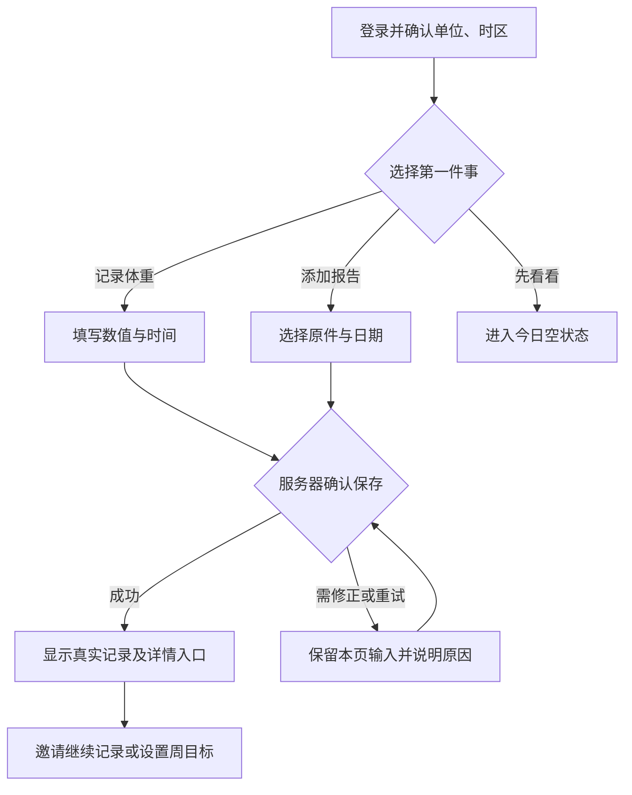
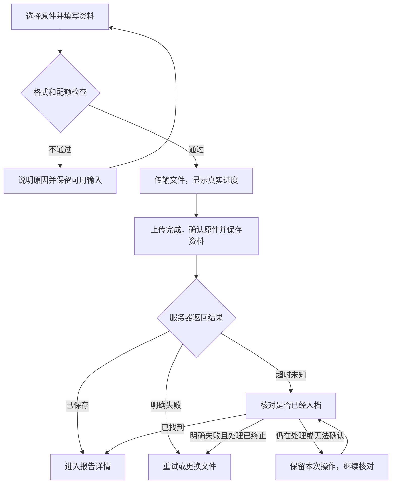
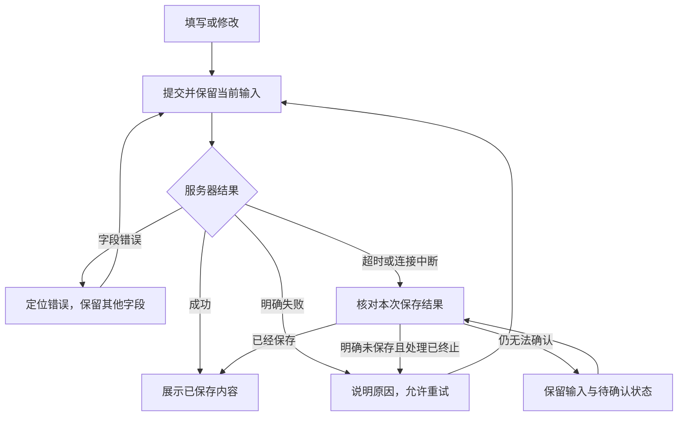

# BodyTrace 产品与界面设计文档

版本 1.0 · 首版网页设计基线 · 2026 年 10 月 12 日 · 适用对象：丹青、设计协作者与 AI 开发工具

配套文档：`BodyTrace_Nextjs_MySQL_Development_Guide.md`。开发文档负责技术架构、业务数据、接口和部署；本文件负责用户看到什么、从哪里开始、如何完成任务，以及每一步如何反馈。

当前仓库数据库基线为 MySQL + Drizzle + mysql2，包管理使用 npm。本文件描述目标产品界面；当前已实现食物库、饮食日记、饮食计划，以及身体变化中的体重、体脂率、血压持续记录。导航和记录模型的后续调整另按用户任务实施。

本文件沿用已经确定的产品方向：**先用 Next.js 上线网页，使用现有 MySQL；饮食和训练作为日常入口，逐步积累个人身体档案，再发展为有资料依据的 BodyTrace 助手；后续只开发苹果客户端。**

本文给出的导航、页面、颜色和交互是可直接实施的设计基线。白色背景与黑色对比的视觉方向属于本次设计建议，尚未经过用户审美评审或真实用户测试。文中的姓名、日期、体重和营养数字均为合成示例，不代表真实个人资料或饮食建议。

---

## 0. 先看这几项决定

| 项目 | 本版决定 |
| --- | --- |
| 产品表达 | 把饮食、训练、身体变化和检查资料放进同一份可回看的个人档案 |
| 一级导航 | **今日、计划、档案、时间线**，手机与桌面顺序一致 |
| 核心动作 | 记体重、记饮食、记训练、添加报告 |
| 第一眼的重点 | 今天可以记录什么、已经记了什么、当前目标是什么 |
| 长期资料的位置 | 档案；报告原件、基础资料、指标记录都能在这里找到 |
| 视觉基线 | 白色背景、黑色对比操作色、中性灰阶、清晰文字、适量留白 |
| 第一版的图表 | 体重真实记录点与列表；数据不足时直接解释 |
| 第一版的助手 | 暂不设置独立聊天入口；以后从已有资料和明确问题进入 |
| 开发顺序 | 先完成“记录一条体重并找回”与“保存一份报告并打开”，再补齐周计划和其他记录 |

### 0.1 如何使用这份文件

第一轮先读第 1—4 节，固定范围、导航和视觉。随后按第 5—11 节实现页面，用第 12—15 节检查共用状态、组件和可访问性。第 17 节给出了可以逐项完成的设计与验收顺序。

首批需要落地的五组界面是：**今日页、体重录入页、报告列表与详情、周计划编辑页、时间线**。每组先做正常状态和关键异常状态，完成一次从入口到真实保存结果的流程后，再推进下一组。

---

## 1. 产品目标与设计边界

### 1.1 用户应当逐渐形成的认识

第一次使用：“我可以很快记下一条身体记录，或者保存一份报告。”

持续使用：“这些资料按日期积累在一起，我能回看过去一段时间的计划、记录和变化。”

后续增加助手：“回答能回到我自己的记录与报告，我可以核对来源。”

首页不需要一次展示最终愿景的所有能力。长期价值通过不断累积的真实资料体现，首版界面只提供已经可以完成的任务。

### 1.2 首版范围与后续范围

本文件中的 **P0** 对应开发文档的 M0 与 M1；“后续”对应使用验证后的 M3 或苹果客户端阶段。P0 是一版完整可用网页的范围，可以分批实现，不要求第一天同时完成。

| 领域 | P0 页面能力 | 后续增加的能力 |
| --- | --- | --- |
| 本人档案 | 基础资料、目标说明、单位、时区 | 更多身体指标、外部数据来源 |
| 身体记录 | 体重录入、历史、修改、删除 | 更多已定义单位和来源的指标 |
| 饮食计划 | 逐天四个目标 + 早/午/晚三餐食物，按日期取当天目标 | 模板、食谱、计划列表与历史回看 |
| 饮食记录 | 摘要与可选手填营养数值 | 常用组合增强、食品库、份量换算 |
| 训练记录 | 类型、发生时间、可选时长和备注 | 动作编排、组数、计时、设备数据 |
| 检查报告 | 原件、标题、日期、分类、打开与下载 | OCR、人工确认、同项指标比较 |
| 时间线 | 聚合已保存的记录和有明确日期的报告 | 更多筛选、来源关联与趋势解释 |
| 数据管理 | 资料导出、更正、删除、实际授权记录 | 共享、更完整的数据迁移 |
| 苹果客户端 | 复用信息结构与接口约定 | SwiftUI、HealthKit、适合移动端的提醒与同步 |

首版只管理本人的资料，不出现家庭成员切换器。现阶段没有上线的 OCR、AI、食品库或 HealthKit，不在导航里放灰色占位入口。

### 1.3 五条设计原则

1. **先让一条记录成立。** 可选资料不应阻挡首次记体重、记饮食或添加报告。
2. **每个数字都能解释。** 说明时间、单位、来源，以及它是目标、实际记录还是部分合计。
3. **已经保存的资料可以找回。** 保存后的列表、详情和时间线指向同一条记录。
4. **反馈与实际处理状态一致。** 请求发出、文件传输结束、资料入档是不同的状态。
5. **以中性语言描述身体变化。** 不通过体重升降自动判断健康好坏，不把未记录说成失败。

---

## 2. 信息架构与导航

### 2.1 四个一级页面

| 导航 | 用户的问题 | 主要内容 | 主操作 |
| --- | --- | --- | --- |
| 今日 | 今天的目标是什么？我记了什么？ | 快捷记录、当日目标、当日实际记录、最近一次体重摘要 | 添加记录 |
| 计划 | 接下来怎么安排？以前的目标是什么？ | 当前、即将开始、已结束的饮食计划 | 创建计划 |
| 档案 | 我的身体资料和报告在哪里？ | 基础资料、身体指标、报告入口 | 添加报告或记录指标 |
| 时间线 | 这一段时间发生了什么？ | 按事件日期排列的体重、饮食、训练和报告 | 切换日期范围、筛选类型 |

账户设置通过头像或“设置”入口进入。**档案是身体资料的归档页**；账号、登录方式、授权和数据管理在设置里。

“添加记录”是各页都可以使用的动作。类型选择器提供“体重、饮食、训练、报告”四项；明确场景中的按钮直接打开对应表单，例如体重页的“记体重”无需再选择类型。

### 2.2 导航在不同屏幕中的表现

- 手机与中等宽度网页：底部四个导航项，图标上方或旁边保留中文名称；当前项通过形状或底色与文字共同标识。
- 桌面网页：左侧栏使用相同顺序，底部放设置入口；内容区域顶部保留页面标题和主操作。
- 一级页面提供顶部“＋记录”。今日页同时提供快捷操作区；表单和报告阅读页减少无关操作。
- 编辑表单在手机上使用独立页面，隐藏底部主导航；顶部提供返回，表单末尾提供保存。
- 从列表进入详情再返回时，保留合理的日期范围、类型筛选和滚动位置。浏览器后退与页面返回应得到一致结果。
- 同一条记录只有一个可分享给自己、需要登录才能访问的详情地址；今日页、档案和时间线复用它。

### 2.3 页面清单

下列是建议的网页路由，属于界面地址，不替代开发文档中的 `/api/v1` 接口。动态参数必须对应真实资料，访问时由服务端核对权限。

| 页面 ID | 页面 | 建议路由 | 用户完成的任务 |
| --- | --- | --- | --- |
| P00 | 登录、注册、找回入口 | `/login`、`/register`、`/recover` | 建立或恢复账户访问 |
| P01 | 首次使用 | `/onboarding` | 确认单位和时区，开始第一条记录 |
| P02 | 今日 | `/today?date=YYYY-MM-DD` | 查看某天目标与实际记录 |
| P03 | 计划列表 | `/plans` | 找到当前、未来和历史计划 |
| P04 | 创建／修改计划 | `/plans/new`、`/plans/:id/edit` | 设置日期与目标，确认影响范围 |
| P05 | 计划详情 | `/plans/:id` | 看每天目标、版本生效范围和当日记录入口 |
| P06 | 身体档案 | `/archive` | 查看资料概况并进入指标或报告 |
| P07 | 基础资料 | `/archive/profile/edit` | 修改本人资料、长期目标说明 |
| P08 | 体重记录 | `/archive/weight` | 查看趋势、原始记录与来源 |
| P09 | 记录新建／详情／编辑 | `/records/:type/new`、`/records/:type/:id`、`/records/:type/:id/edit` | 保存和更正体重、饮食或训练记录 |
| P10 | 报告列表 | `/archive/reports` | 按日期或分类找回原件 |
| P11 | 添加报告 | `/archive/reports/new` | 上传原件并补充资料 |
| P12 | 报告详情 | `/archive/reports/:id` | 阅读、下载、修改描述或删除报告 |
| P13 | 时间线 | `/timeline` | 回看一段时间内的资料 |
| P14 | 设置 | `/settings` | 管理账户、偏好和实际授权 |
| P15 | 数据管理 | `/settings/data` | 导出资料、查看任务、删除账号 |

`:type` 仅使用已支持的 `weight`、`diet`、`training`。新建、详情和编辑复用字段与展示组件，但使用不同操作模式。报告走专用页面，避免把文件上传塞入通用数字表单。

---

## 3. 首次使用与核心流程

### 3.1 注册前的说明

访问入口使用一屏可理解的介绍：

> **把身体记录，慢慢连成自己的档案。**\
> 记录饮食和训练，保存检查报告，按日期回看身体变化。

主按钮“开始建立档案”，次入口“已有账号，登录”。实际使用什么注册方式，由开发文档和已接通的认证能力决定；不展示无法使用的第三方登录按钮。

介绍页只呈现真实已有能力。演示内容标为“示例资料”，不得在新用户个人首页中冒充已有数据。隐私与资料处理说明应当容易找到，文案只承诺实际实现的保护方式。

### 3.2 首次使用不做长问卷

账号创建后确认两个可修改的偏好：**体重显示单位、记录时区**。浏览器推断的时区只作为初始值，并显示“请确认”；首版单位控件只列出后端已经支持的单位。

昵称、身高、出生信息、目标说明等可以稍后在基础资料中补充。确实需要用于某项功能时，再说明用途并请求对应字段。

随后给出两个清楚的起点：

- 主入口：“记录第一次体重”。
- 次入口：“先添加一份报告”。

用户也可以“先看看”。跳过后显示正常空状态；不要强制建好饮食计划才允许记录。

首次保存身体记录或报告前，按本次实际处理用途展示说明并完成所需确认；已经有效记录、用途和范围未改变的授权不重复索取。授权记录保存实际说明文本版本、用途范围与确认时间。需要确认时，拒绝或暂不确认不会制造一条已保存记录，页面解释哪些操作暂时无法继续。



### 3.3 第一轮体验的完成标准

用户保存一条记录后，能在当前页面找到它、进入详情核对日期与数值、返回列表。退出并重新登录后，这条记录仍可访问。

这一流程完成前，不插入订阅弹窗、全屏勋章或多步产品教学。引导以当前任务所需的简短说明为主。

---

## 4. 视觉系统与响应式布局

### 4.1 视觉方向

采用适合频繁查看数字和文档的安静界面：白色背景承载内容，黑色用于主操作、选中状态和对比面板，其余层级用中性灰阶区分，正文保持足够深。页面以标题、分组列表和稳定间距建立层级。

品牌名称暂以 **BodyTrace** 文字标识呈现，正文不依赖专门定制的 Logo 或插画才能完成。首版先统一明亮模式；深色模式需要独立颜色校验后再交付。

黑色表示产品主操作，不表示某项身体数据“正常”。身体趋势图表用灰阶区分序列。危险操作采用红色，并明确说明操作对象。

### 4.2 颜色令牌

| 令牌 | 色值 | 使用规则 |
| --- | --- | --- |
| `canvas` | `#FFFFFF` | 页面背景 |
| `surface` | `#FFFFFF` | 内容分组、表单、浮层 |
| `text` | `#111111` | 标题、正文、主要数值 |
| `text-secondary` | `#6F6F6F` | 日期、说明、次要标签 |
| `text-muted` | `#6F6F6F` | 白色或页面背景上的辅助文字；不用于浅灰背景小字 |
| `brand` | `#111111` | 主按钮、链接、选中标记 |
| `brand-hover` | `#111111` 80% 不透明度 | 主按钮悬停与按下反馈 |
| `brand-soft` | `#F5F5F5` | 选中底色；文字使用 `brand` 或 `text-secondary` |
| `border` | `#E8E8E8` | 装饰性分隔线，不单独承担输入框识别 |
| `control-border` | `#D4D4D4` | 输入边界等装饰性轮廓；识别依赖标签与聚焦描边 |
| `critical` | `#DC2626` | 明确错误、删除操作 |
| `chart-1`–`chart-5` | `#171717`→`#D4D4D4` 灰阶 | 图表序列、图例色点与进度条 |
| `brand-panel` | `#111111` 底、`#E5E5E5` 强调 | 登录侧栏、今日能量卡等黑色对比面板 |

按 WCAG 的相对亮度公式计算，下列是不透明纯色组合的近似对比度：正文／白色约 **18.9:1**，次要文字／白色约 **5.0:1**，白字／主按钮约 **18.9:1**。输入框边界为装饰性浅灰（约 1.5:1），不单独承担识别；聚焦时使用黑色描边。图表灰阶中最浅的序列（约 2.5:1）只用于粗线条与色点，不用于文字。这些计算只验证指定颜色组合；透明度、渐变、图片背景和实际组件状态仍需逐项检查。[D01][D02]

`text-muted` 放在 `brand-soft` 上约为 4.6:1，不作为普通字号文字组合使用。浅分隔线只用于分组，输入框识别依赖标签与聚焦描边。

### 4.3 字体、间距和形状

| 类型 | 网页设计值 | 说明 |
| --- | --- | --- |
| 页面标题 | 手机 24/32，桌面 28/36，字重 600 | 数值为字号／行高，单位 CSS px |
| 区块标题 | 18/26，字重 600 | 如“今日目标”“最近记录” |
| 正文与输入 | 16/24，字重 400 | 中文段落可采用 1.6 倍行高 |
| 次要说明 | 14/21，字重 400 | 来源、日期、单位说明仍需可读 |
| 核心指标 | 32/40，字重 600 | 单位靠近数值，使用等宽数字特性 |
| 导航标签 | 14/20，选中时 600 | 图标不能替代名称 |
| 间距 | 4、8、12、16、24、32、48 | 同类元素使用同一组间距 |
| 圆角 | 输入与按钮 10，分组容器 16，浮层 20 | 同一层级保持一致 |
| 按钮高度 | 常用操作 44，主要表单按钮 48 | CSS px；文字放大时允许增高 |
| 图标 | 通常 20，重要操作可用 24 | 统一线性风格；点击区域扩大到项目目标尺寸 |

字体优先使用系统字体，覆盖中文与数字；无需为首版加载多个外部字体。正文不做大面积全大写或大段低对比度细字。

一组同类记录使用一个容器与分隔行；关键摘要可以独立卡片。避免给每一行都加厚阴影、边框和独立背景。阴影主要用于浮层的前后关系。

交互过渡建议 120—180 ms，主要用于颜色、显隐和轻微位置变化。这些是项目参数；在用户开启减少动态效果时去掉非必要移动动画。

### 4.4 布局规则

| 宽度 | 导航与布局 | 内容尺寸 |
| --- | --- | --- |
| 320—767 CSS px | 底部四项导航；单列 | 两侧 16 px，列表内容随宽度换行 |
| 768—1023 CSS px | 保留底部导航；内容居中 | 主内容最大 760 px，两侧至少 24 px |
| 1024 CSS px 及以上 | 左侧导航约 224 px；主内容居中 | 主内容最大 1120 px，外侧间距通常 32 px |
| 1280 CSS px 及以上的报告详情 | 原件预览与资料说明双列 | 预览获得更多空间；窄屏恢复单列 |

表单正文最大宽度建议 560 px；双列表单只用于字段明确成组且确有空间的场景。横向空间不足时上下排列，不缩小标签和输入字号。

手机底部导航预留安全区域，正文底部预留导航所占空间。表单保存操作不能遮挡最后一个字段或错误文字；键盘弹出后页面仍可滚动至提交区域。不要通过固定整页高度截断内容。

### 4.5 CSS 令牌示例

以下是语义令牌示意，接入时映射到项目现有主题。shadcn/ui 官方推荐通过 CSS 变量组织主题；组件默认外观仍需按本文件调整。[D07]

```css
:root {
  --bt-canvas: #f6f7f3;
  --bt-surface: #ffffff;
  --bt-text: #202824;
  --bt-text-secondary: #53625b;
  --bt-text-muted: #64716a;
  --bt-brand: #246b58;
  --bt-brand-hover: #1b5143;
  --bt-brand-soft: #e8f1ec;
  --bt-border: #dde4de;
  --bt-control-border: #7a887f;
  --bt-info: #245c86;
  --bt-warning: #805700;
  --bt-critical: #b42318;
  --bt-chart-primary: #356f91;
  --bt-radius-control: 10px;
  --bt-radius-panel: 16px;
  --bt-content-max: 1120px;
}

body {
  font-family: -apple-system, BlinkMacSystemFont, "Segoe UI",
    "PingFang SC", "Hiragino Sans GB", "Microsoft YaHei", sans-serif;
  color: var(--bt-text);
  background: var(--bt-canvas);
}

.bt-number { font-variant-numeric: tabular-nums; }

:focus-visible {
  outline: 2px solid var(--bt-brand);
  outline-offset: 3px;
}

@media (prefers-reduced-motion: reduce) {
  .bt-motion { animation: none; transition: none; }
}
```

焦点样式必须在具体背景、浮层和裁切容器内验证。此代码用于建立外观基线，不代表已经通过完整可访问性评估。

---

## 5. 今日页 P02

### 5.1 页面目的与纵向顺序

| 顺序 | 模块 | 内容与操作 |
| --- | --- | --- |
| 1 | 标题和日期 | “今日”及完整日期；切换历史日期后显示具体日期与“回到今天” |
| 2 | 快捷记录 | 记体重、记饮食、记训练、添加报告 |
| 3 | 当日目标 | 显示当日生效的计划名称与目标，提供“查看计划” |
| 4 | 当日记录 | 饮食、训练、体重按实际时间排列，摘要可点击进入原记录 |
| 5 | 最近身体记录 | 最近一次体重、实际日期与来源，进入体重页 |

手机快捷区采用两行两列的大按钮，短标签配图标；桌面可以横排。页面上部优先让用户找到记录入口，不用大幅宣传图占满首屏。

“最近身体记录”如果与当日体重重复，可以合并为当日记录区域中的体重摘要。报告的主要找回入口是档案和时间线；今日页只展示检查日期明确属于当天的报告行，未知检查日期的报告不算作今日检查。

### 5.2 目标与实际的展示方式

目标区域明确标为“今日目标”，示例：

> 工作日安排 · 10 月 12 日\
> 能量 1,900 kcal · 蛋白质 110 g · 碳水 230 g · 脂肪 60 g\
> 查看计划

以上数字仅演示布局。目标由用户填写或从已确认计划取得，首版不会根据基础资料自动开具饮食方案。

饮食记录区域独立显示：

> 已记录 2 次饮食\
> 已填写能量合计：460 kcal\
> 另有 1 条记录未填写能量

各项营养合计独立统计已知数值。即使已经保存的记录都填了能量，仍不能证明用户当天所有饮食均已记录；首版统一使用“已填写……合计”，不显示默认的“全天摄入”“剩余可吃”或确定的达成百分比。

### 5.3 空状态

| 情况 | 文案 | 操作 |
| --- | --- | --- |
| 完全没有记录 | “从一条记录开始，慢慢建立自己的身体档案。” | 记体重；添加报告 |
| 当天没有目标 | “这一天还没有设置饮食目标。” | 设置周目标 |
| 有目标但没有记录 | “目标已设置，可以从记下第一餐开始。” | 记饮食 |
| 当天无记录但历史有资料 | “这一天还没有记录。” | 添加记录；回到今天 |
| 没有体重记录 | “还没有体重记录。” | 记体重 |

首次空状态只突出一个主动作，其他入口保持可见但不过度强调。加载期间使用骨架或进度说明，读取失败显示重试，不提前显示“没有记录”。

### 5.4 用户可见的完成标准

从昨天进入录入表单时，标题或日期区域说明“记录到 10 月 11 日”。保存后返回昨天，并看见该记录。修改或删除后，当日列表、最近体重和档案页同步反映权威结果。

---

## 6. 快速记录 P09

### 6.1 共用结构

顶部：返回、明确的任务标题，如“记录体重”或“修改 10 月 11 日的体重”。

正文：主要内容、发生时间、可选信息。单位始终靠近输入框，字段使用可见标签；占位文字只给例子。

底部：主按钮“保存记录”或“保存修改”，次操作“取消”。编辑已有记录时，删除放在更多操作或表单底部的独立危险操作区，避免与保存相邻造成误触。

新建表单不直接把上次的数值当作本次已输入内容。可在旁边显示“上次：86.6 kg · 10 月 10 日”帮助核对。

### 6.2 体重表单

| 字段 | 要求 | 初始值与说明 |
| --- | --- | --- |
| 体重 | 必填 | 空值；支持后端约定的小数精度 |
| 单位 | 必填 | 账户已确认且服务端支持的单位；始终可见 |
| 测量日期与时间 | 必填 | 当前上下文日期；可改为实际发生时间 |
| 备注 | 可选 | 例如“晨起后记录”，不默认代填 |

示例仅使用 kg。若增加斤或 lb，必须先定义换算、输入精度与原单位保留，再显示选项。不要只换单位标签却保持未换算数字。

空值、非数字和非正数明确报错。超出产品合理输入边界时提示核对数值和单位，具体边界由数据契约定义，不能自动改成猜测的“正常”值。实际记录不接受未来发生时间；用户若在安排未来事项，应进入计划。

同一天可以多次记录，均保留。摘要如果仅显示一个值，标为“今日最近一次”或“最近一次”，并给出时间。更正通过编辑指定记录完成，不借由新增记录覆盖旧值。

### 6.3 饮食表单

| 字段 | 要求 | 展示与校验 |
| --- | --- | --- |
| 用餐日期与时间 | 必填 | 明确所属日期，可补录过去 |
| 餐次 | 必选 | 早餐、午餐、晚餐、加餐；不根据时间自动确认 |
| 吃了什么 | 必填 | 一句摘要，例如“鸡腿饭，米饭半份” |
| 能量 | 可选 | 手动填写，单位 kcal；未填就是未知 |
| 蛋白质、碳水、脂肪 | 分别可选 | 手动填写，单位 g；各项独立保存 |
| 备注 | 可选 | 补充说明 |

营养字段可以折叠在“补充营养数值”下，默认先展示摘要与时间，降低录入负担。折叠标题提示“可选，手动填写”；展开后必须能顺利用键盘访问。

用户只写摘要就可以保存。同一餐次可以有多条记录。首版每条表示一次饮食记录，不同时引入“整天能量汇总”作为可叠加的另一种记录，避免重复合计。

食物名称不会自动生成营养数字。若未来提供常用组合，选择组合先填入待确认的新表单，允许修改内容和日期后再保存。

### 6.4 训练表单

| 字段 | 要求 | 展示与校验 |
| --- | --- | --- |
| 训练类型 | 必选 | 力量、步行、跑步、骑行、游泳、其他 |
| 发生日期与时间 | 必填 | 当前上下文，可补录过去 |
| 时长 | 可选 | 单位分钟；填写时必须是有效正数 |
| 备注 | 可选 | 一句摘要，例如“上肢训练，整体感觉轻松” |

不知道时长时可以留空，列表显示“时长未填写”。不推算运动消耗，不自动将一条训练记录标为某个未关联计划的完成结果。尚未实现的训练编排能力不在表单中出现。

### 6.5 记录详情

详情显示实际内容、发生日期与时间、原单位和“手动记录”等来源说明。修改时间作为次要信息；不要用它代替发生时间。

有编辑权限时显示“编辑”和“删除”。从今日、时间线或档案进入同一记录时，内容与修改结果一致。

---

## 7. 饮食计划 P03—P05

当前实现是「逐天目标 + 三餐食物」：一周七天（周一→周日）逐天编写，每天填热量/蛋白/碳水/脂肪四个目标，并为早餐、午餐、晚餐各挑具体食物与克数。摄入由食物库每 100g 数值乘克数实时折算，计划里不保存营养快照。每用户只有一份计划，没有版本历史；保存是整份覆盖，会改写起始日（含）之后所有日期的目标与三餐食物，包括已经过去的日期。

### 7.1 编辑器的组织方式（已实现）

按周一到周日排成七张卡，每天一张：

1. **目标**：四个数值输入，带标签与单位（千卡 / 克），取值范围与服务端校验一致。
2. **三餐食物**：早餐、午餐、晚餐各一区；每行显示食物名、克数输入与该行折算出的热量与三大营养素，行尾可删除；餐次标题显示该餐小计热量。
3. **全天对照**：该天合计与四个目标并排，给出带正负号的差值，用于逐日核对，不构成健康结论。

手机单列显示，窄屏时每天可折叠，默认只展开今天；折叠后卡头仍显示该天合计与目标热量。桌面沿用同一份日编辑器，不要求同时操作大量输入框。

### 7.2 添加食物的来源（已实现）

三餐里的“添加食物”打开选择弹层，来源与饮食日记一致：最近吃过、收藏、搜索个人食物库、参考库。选中后只把“个人 food.id + 食物名 + 每 100g 营养”回调到计划表单的本地状态，**不写饮食记录**；计划项引用的是个人 food.id，所以参考库条目要先抄进个人食物库再被选中，与日记页共用同一套接口与提示文案。

计划项不存营养快照：改克数按当前食物库数值重算；食物被删除时该行只保留名称与克数，界面标注“食物已删除，请重新选择”，并且不计入合计；保存前会提示先删除或重选，避免静默丢行。

### 7.3 保存语义与提示（已实现）

保存提交“起始日 + 生效状态 + 七天四项目标 + 三餐食物项（餐次、食物引用、克数）”，成功后用服务端读回的计划覆盖本地状态（拿到 id、原始每 100g 营养与实时折算营养）。保存和删除期间禁用目标、克数、日期、生效状态、食物增删与提交操作，避免重复提交或响应覆盖等待期间的新编辑；400（食物不存在或不属于当前用户）时保留已填内容并可重试。

起始日期可选今天或更早的日期（不晚于今天）。起始日早于今天时，编辑区明确提示：保存会改写起始日（含）之后所有日期的目标与三餐食物，包括已经过去的日期，整份计划会被替换且没有版本历史可回退；已记录的摄入快照不变，只是那些天用来对照的目标会变成新值。停用后所有日期回到每日目标，配置保留；删除计划需二次确认。

### 7.4 后续能力

- 计划列表（“当前 / 即将开始 / 已结束”分组）与多计划并存。
- 模板：以一份可核对的预填排布开始，先看七天数值与来源再确认套用。
- 结束计划、按日期回看当时生效的目标、周复盘与完成率——这些依赖计划版本模型与数据迁移，不能用文案替代。
---

## 8. 身体档案与体重趋势 P06—P08

### 8.1 档案首页

按以下顺序组织：

| 区域 | 内容 | 操作 |
| --- | --- | --- |
| 基础资料摘要 | 用户称呼、已填写的基础资料、目标说明 | 编辑资料 |
| 身体指标 | 最近一次体重、日期、来源 | 查看体重记录；记体重 |
| 检查报告 | 报告数量、最近的几份标题与日期 | 查看全部；添加报告 |

资料摘要不显示未填写字段的长串横杠，也不制造“档案完成度 30%”来强迫补充不必要信息。

当前体重来自测量记录，不在基础资料中再维护一个独立可编辑的“当前体重”。长期目标说明与每天的营养目标分开：修改基础资料不自动修改正在执行的计划。

### 8.2 基础资料表单

首版只展示已经有用途和数据契约的字段，例如昵称、可选身高、目标说明。单位与时区在设置中统一维护，档案可以提供链接。

出生信息、生理性别等字段只有在当前能力确实需要时再加入，并说明用途；不要为了界面看起来完整而强制收集。用户未填写时，依赖该信息的功能说明需要补充什么，其他功能继续可用。

### 8.3 体重页布局

当前实现统一入口 `/measurements`“身体变化”，可切换体重、体脂率和血压，复用下述录入、筛选、趋势和历史流程。三类指标各自解析最新值；血压的收缩压和舒张压成对录入，并须选择晨间或夜间时段，趋势图中晨/夜各一组收缩压、舒张压同屏对比，缺哪个时段哪条线就断开；概要卡血压的“较上一次”按同时段比较，不把昼夜差异混进变化值。迁移前的旧血压按测量时间回填时段，无时间的保持未标记并在编辑时补选。旧资料体重保留作参考，不自动生成测量历史。

顶部显示“最近一次：86.4 kg · 10 月 12 日 08:15 · 手动记录”，旁边提供“记体重”。接着是日期范围切换、趋势区域、原始记录列表。

首版范围可用“近 7 天、近 30 天、近 90 天、全部”；默认近 30 天。图表与列表使用同一筛选范围。

| 数据情况 | 图表表现 | 文字说明 |
| --- | --- | --- |
| 无记录 | 简短空状态，无虚构曲线 | “这个时间段还没有体重记录。” |
| 只有一条 | 一个带日期的点 | “已有 1 次记录，继续记录后可以回看变化。” |
| 多条记录 | 实际时间与数值的点，必要时用直线连接可比较点 | 显示范围、记录次数和单位 |
| 中间缺少日期 | 保留真实时间间隔；按日图在缺失日断开 | 不补成零，不生成中间测量值 |
| 同日多条 | 保留所有原记录；如按日聚合，明确“当日最近一次” | 列表可以查看当天其他测量 |

默认不使用平滑曲线，以免暗示实际没有记录的细微变化。纵轴不必从零开始，但必须标明范围，避免通过过窄坐标夸大变化。首版不增加没有定义的预测线。

图下提供简短事实说明，例如“所选范围内共 6 次记录；首条 86.8 kg，末条 86.4 kg，相差 −0.4 kg”。比较取自同一明确范围，注明日期；不写“计划让你减重 0.4 kg”。

趋势页提供等价的文字列表。点击、键盘操作或屏幕阅读器都能获得数值和日期，不能只依赖鼠标悬停。颜色承担区分作用，指标与状态仍有文字。[D02][D04][D06]

---

## 9. 检查报告 P10—P12

### 9.1 报告列表

标题“检查报告”，主按钮“添加报告”。每行显示：报告标题、检查日期或“检查日期未填写”、分类、文件类型与大小。手机第二行允许换行，长标题不能挤掉日期与操作。

分类首版可用“体检、检验、影像、其他”。这些是用户整理资料的分类，不能代表已完成医学识别。检索若提供，范围明确为用户填写的标题；没有 OCR 时不声称可以检索报告正文。

有检查日期的报告按日期排序；日期未知的报告放在“日期待补”分组。分组中可按上传时间排序，并明确该时间含义。

### 9.2 添加报告表单

| 内容 | 要求 | 交互 |
| --- | --- | --- |
| 原文件 | 必选 | P0 一次添加一份；显示文件名、大小与可用缩略预览 |
| 报告标题 | 必填 | 可从文件名生成初始标题，用户确认或修改 |
| 检查日期 | 可选 | 只知道日期就保存日期；可以稍后补充 |
| 分类 | 必选 | 默认“其他”，允许调整 |
| 备注 | 可选 | 用户补充上下文 |

首版支持范围以实际验证过的 PDF、JPEG、PNG 为基线，页面只列出服务器已支持格式。HEIC 若尚未实现可靠处理，应在选择前说明可用格式，遇到不支持文件时给出转换或重选建议。

沿用开发文档的内测建议：单文件 20 MB、PDF 最多 30 页；这些是可调整的产品配置。展示的限制必须与服务器一致。无法在浏览器提前核对的条件，在服务器核验阶段反馈具体原因，不伪装成已验证。

PDF 加密、文件损坏和不支持格式分别说明。原件不能预览时，不把“无法预览”自动解释为“文件不存在”；是否允许保存由真实校验结果决定。

### 9.3 上传与入档的流程



| 状态 | 显示内容 | 可用动作 |
| --- | --- | --- |
| 尚未选择 | “添加一份检查报告”与格式限制 | 选择文件 |
| 已选择 | 文件名、大小、资料表单 | 更换文件、保存报告 |
| 正在上传 | “正在上传 42%”；没有可靠进度时显示不定进度 | 系统支持时取消 |
| 传输完成 | “上传完成，正在保存报告…” | 等待确认 |
| 已保存 | “报告已保存”及可访问详情 | 查看原件、下载 |
| 预览失败但已保存 | “报告已保存，暂时无法预览” | 重试预览、下载原件 |
| 明确失败 | “上传没有完成，请重试”或具体校验原因 | 重试、重选 |
| 保存结果未知 | “正在确认报告是否已保存” | 核对结果，避免重复生成报告 |

进度 100% 只表示传输完成。最终成功以服务器确认报告已入档且用户有可访问的原件入口为准。暂时没有查到最终报告，不代表本次保存已经失败；仍在处理或无法确认时继续核对原操作，不重新创建另一份报告。V1 不出现“识别中”“待审核”“AI 分析完成”。

用户取消上传后，如果服务器实际已经完成入档，列表正常显示这份报告并允许删除；不能假装取消已经撤回服务器完成的结果。离开上传页时说明可能中断，不承诺关闭网页后后台继续上传。

### 9.4 报告详情布局

顶部：报告标题、检查日期状态、分类。主操作“查看原件”，次操作“下载”。“修改资料”和“删除报告”放在清楚但不抢占主操作的位置。

手机：资料摘要在上，原件预览或“打开原件”入口在下；文件较长时使用可访问的浏览器阅读方式。桌面宽屏：左侧原件预览，右侧标题、日期、文件信息和备注。首版可以复用浏览器 PDF 阅读能力，不要求自建复杂阅读器。

日期字段分别标明含义：用户填写的检查日期、系统记录的上传时间、必要时的修改时间。检查日期缺失时显示“未填写”，不以上传时间代替。

详情的“修改资料”只修改标题、分类、日期和备注，不替换已保存原件。需要保存另一份原文件时新建报告；更复杂的关联版本在后续设计。

下载链接过期时显示“下载链接已过期，请重新获取”，通过已登录的权限校验生成新链接。下载开始后说明“请查看浏览器下载列表”，不能证明用户已经把文件安全备份。

---

## 10. 时间线 P13

### 10.1 组织方式

页面顶部提供日期范围和类型筛选：“全部、体重、饮食、训练、报告”。筛选支持组合时应显示已选范围；首版也可采用单类型切换，但全站保持一致。

时间线按实际事件日期分组，新日期在上；同日具有时间的记录按时间排序。只知道日期的报告保留日期精度，并显示“当天，时间未记录”，不伪造具体钟点参与精确排序。

| 类型 | 行的主要信息 | 进入的详情 |
| --- | --- | --- |
| 体重 | 数值、单位、测量时间、来源 | 同一条体重记录 |
| 饮食 | 餐次、摘要、时间；营养值按已知内容显示 | 同一条饮食记录 |
| 训练 | 类型、时长或“未填写”、时间 | 同一条训练记录 |
| 报告 | 标题、检查日期、分类 | 报告原件详情 |

完全不知道检查日期的报告不插入某个临床日期分组，放在独立的“日期待补资料”入口，标明数量。默认视图保持这一入口可见；选择限定日期范围后说明这些资料尚未计入日期筛选。

P0 时间线聚合真实记录；未来的饮食安排仍在计划页。第一版不额外把每个计划目标展开为时间线事件，避免重复占据历史记录区域。

### 10.2 空状态与返回

没有任何资料：“保存记录或报告后，可以在这里按日期回看。”

筛选没有结果：“这个日期范围内没有符合条件的资料。”操作为“清除筛选”，同时保留日期调整入口。

详情返回后恢复用户原有筛选与位置。加载更多时保留已显示内容，失败可在列表末尾重试，不把整个时间线清空。

---

## 11. 设置、授权与数据管理 P14—P15

### 11.1 设置结构

设置分为账户、记录偏好、资料与授权三个分组。账户显示实际可管理的登录方式与退出入口；记录偏好包括已支持单位和时区；资料区域提供导出、授权记录及删除账号。

更改显示单位后，已有记录的原单位仍可在详情核对。更改当前时区不能把历史计划的日期重新分配；受影响的页面提示当前显示所用时区。

只有实际接入、得到授权的能力才出现在授权管理中。首版可以展示服务已记录的资料处理授权与对应说明，不预先制造 HealthKit 或第三方 AI 的已连接状态。新用途需要独立说明，不能以新增界面默认扩大旧授权。

已授权条目提供“查看说明”和“撤回授权”。撤回前列出受影响的具体能力；用户确认后以服务器结果更新为“已撤回”，记录撤回时间，并停止依赖该授权的新处理。正在进行的任务在提交结果前重新核对授权状态。撤回请求失败或结果未知时，保留相应状态和核对入口，不提前宣布撤回成功。资料删除仍通过数据管理流程完成，界面说明撤回与删除各自的实际影响。

### 11.2 导出

入口“导出我的资料”。操作前说明包含结构化记录与报告原件；使用开发文档约定的可理解目录与清单。若该版本只支持全量导出，就只提供全量选项。

| 状态 | 文案与结果 |
| --- | --- |
| 空档案 | “目前还没有可导出的资料。” |
| 已开始处理 | “正在准备资料…”；长任务可稍后回到本页查看 |
| 准备完成 | “资料已准备好”与“下载” |
| 部分原件缺失 | 说明数量与缺失部分，提供处理方式，不称为完整导出 |
| 失败 | “资料暂时没有准备成功，请重试。”并保留选项 |
| 下载过期 | “这份下载已过期，请重新生成。” |

敏感资料导出页不把公开分享作为默认动作。进度只有服务器能提供可靠数据时才显示百分比。

### 11.3 删除记录、报告和账号

删除单条体重时，确认文案明确对象：“删除 10 月 12 日 08:15 的这条体重记录？”辅助说明：“相关列表与趋势会更新。”按钮为“取消”和“删除记录”。

删除报告时显示标题，并说明原件一并进入删除处理。没有实现恢复能力时，不提供虚假的“撤销删除”。

删除账号使用独立确认页面或适当对话框，说明账号、记录和报告涉及的范围，提供可选导出入口以及实际备份保留说明；必要时重新验证身份。用户不必先完成导出才能删除。

收到删除请求与删除全部完成分别反馈。例如：“删除申请已受理。资料已停止展示，正在完成删除。”只有真实得到对应完成结果才声明完成。备份保留时长和完成通知方式必须取自实际运行流程，不在设计稿里虚构天数。

删除后的旧链接不再显示资料。不可访问提示统一说明“这条资料目前无法访问”，不透露其他账户是否存在同名报告。

---

## 12. 共用状态与恢复流程

### 12.1 保存状态



重复点击、重试和页面恢复需要与开发文档的幂等与版本处理配合。前端禁用按钮只能减少误触，不能独自保证不重复保存。

### 12.2 通用状态文案

| 状态 | 文案示例 | 页面行为 |
| --- | --- | --- |
| 首次加载 | “正在加载记录…”或骨架 | 不先显示空档案 |
| 刷新失败但已有内容 | “暂时无法更新，以下为上次加载的内容。” | 保留已有资料和重试入口 |
| 保存中 | “正在保存…” | 防止重复提交，保留字段 |
| 已保存 | “已保存体重记录” | 展示真实结果，提供详情入口 |
| 明确保存失败 | “没有保存成功，内容仍在本页。” | 允许重试 |
| 结果尚不明确 | “正在确认是否已保存。” | 先查本次操作结果 |
| 字段校验失败 | “请填写有效的体重数值。” | 错误文字靠近字段，定位首个错误 |
| 离线 | “当前网络不可用，暂时无法保存。” | 当前页面保留输入，恢复后由用户继续 |
| 登录失效 | “登录已失效，请重新登录继续。” | 保护资料展示，保留可恢复的当前任务 |
| 版本冲突 | “这条记录已有更新，请查看最新内容。” | 保留本次输入供核对，不静默覆盖 |
| 资料不可访问 | “这条资料目前无法访问。” | 返回列表，不泄露其他用户信息 |

成功提示可以短暂出现，但成功结果必须在页面中持久可见。错误、保存结果未知和需要用户操作的提示不应快速自动消失。

### 12.3 输入保留与退出

首版只承诺**当前页面生命周期内的输入保留**。没有实现可靠草稿恢复前，不显示“已自动保存”，不承诺关闭网页后能够恢复，也不默认把健康输入写入浏览器长期存储。

尚未提交或已经明确保存失败时，应用内返回或取消先询问：“还有内容未保存，确定离开吗？”按钮“继续填写”“放弃并离开”。

操作已提交且仍在保存或结果未知时，提示：“这次操作仍在确认中。离开不会撤回已经提交的内容，返回后请先查看结果。”按钮“继续等待”“离开页面”。不能把这一状态称为已经放弃或取消保存。

浏览器刷新和系统关闭可能无法可靠拦截，页面不能据此保证不丢稿。

登录失效后，尽可能在同页受保护的重新登录流程中保留内存输入；同一账号恢复后由用户确认继续保存。若流程必须整页跳转且会丢失输入，应在跳转前如实说明当前限制，不能承诺恢复。

用户主动退出时清理本页健康输入。重新登录为另一个账号时，旧账号的未保存资料不得自动写入新账号。

### 12.4 页面错误与浮层

表单错误用字段说明；整个页面无法加载时用页面内错误区域；短暂成功用状态提示；删除等影响明确的动作使用确认对话框。不要把所有情况都做成打断式弹窗。

对话框打开后焦点进入框内，Tab 在框内移动，关闭后回到触发处或合理的后续位置；常规对话框支持 Escape 关闭，涉及未保存输入时执行相应离开检查。危险操作优先把初始焦点放在较安全的动作或说明上。[D05]

---

## 13. 组件规范与开发映射

基础组件可在现有 shadcn/ui 上统一主题；业务组件由 BodyTrace 自己定义数据与状态。一个组件的默认外观并不决定它是否已满足产品含义或可访问性要求。[D07]

| 组件 | 内容与状态 | 设计要求 |
| --- | --- | --- |
| `AppShell` | 导航、页面标题、设置、快捷入口 | 四项顺序一致，主内容与安全区不被遮挡 |
| `Button` | 主、次、文本、危险、加载、不可用 | 有明确动词；图标按钮有可访问名称 |
| `Field` | 标签、输入、单位、说明、错误 | 标签始终存在；可选项明确；错误关联字段 |
| `MetricSummary` | 数值、单位、日期、来源 | 不接受“无值时默认 0”的展示约定 |
| `SourceLabel` | 手动记录、报告原件、未来设备来源 | 文本说明来源；不只用图标或颜色 |
| `RecordRow` | 类型、摘要、事件时间、详情入口 | 有确定目标；更多操作不与整行链接冲突 |
| `DailyTarget` | 日期、目标、未设置项 | 明确目标语义，与实际合计分开 |
| `DaySelector` | 日期、选中、未设置、历史只读 | 可以键盘与触控操作，选中状态有文字或形状 |
| `WeightChart` | 时间范围、真实点、单位、空状态 | 同时提供记录列表；缺失与聚合规则明确 |
| `ReportRow` | 标题、检查日期状态、分类、文件 | 原件可找回，未知日期不被上传时间替代 |
| `UploadProgress` | 选择、传输、保存、成功、失败、未知 | 100% 与已入档分开；只显示真实进度 |
| `EmptyState` | 原因、下一步 | 初次无数据、筛选无结果和加载失败分别处理 |
| `InlineNotice` | 提示、警告、错误、重试 | 同时有文字与操作；重要内容不自动消失 |
| `ConfirmDialog` | 对象、影响范围、确认、取消 | 焦点合理；明确操作后果 |

同类组件统一命名和接口。先实现一套体重录入与报告展示，再复用它们的布局、字段错误和状态逻辑；避免每个页面生成一套不同的按钮与卡片。

---

## 14. 内容与数字表达

### 14.1 推荐文案

| 场景 | 使用 | 避免 |
| --- | --- | --- |
| 未记录饮食 | “今天还没有饮食记录。” | “摄入 0 kcal” |
| 缺少营养数字 | “能量未填写” | 根据摘要自动给出精确数字 |
| 部分合计 | “已填写能量合计” | “今日总摄入” |
| 未记录训练 | “还没有训练记录。” | “今日训练失败” |
| 体重变化 | “较上次 −0.3 kg”，附两次日期 | “恭喜，你变健康了” |
| 报告存入 | “报告已保存” | “报告分析完成” |
| 日期未知 | “检查日期未填写” | 用上传日期冒充检查日期 |
| 历史目标 | “当时生效的目标” | 用今天的目标替换历史解释 |
| 保存不确定 | “正在确认是否已保存。” | 直接断言失败并再次新建 |
| 数据不足 | “当前记录不足以进行这项比较。” | 生成健康分数补空白 |

### 14.2 日期、数字和来源

- 日期首次出现时包含年、月、日；同一天内的记录可以简写时间。跨年列表必须展示年份。
- 只有日期的数据始终按日期显示。时区影响记录归属时提供可核对说明，历史计划使用其原有日期语义。
- 数字精度遵循业务字段约定。输入、详情和图表不得各自采用不同的四舍五入规则。
- 数值与单位一起显示，如 `86.4 kg`、`460 kcal`、`30 分钟`；不通过图例让用户猜单位。
- 空值显示“未填写”或“未设置”；明确的零值只有在该字段允许且用户确实输入时才显示为零。
- 来源标签说明“手动记录”“报告原件”等事实。后续 OCR 的“待确认”与用户已确认结果分开。
- 示例数据、设计稿与测试资料统一标明“示例”，不取真实用户报告作为公开演示素材。

---

## 15. 可访问性与苹果端延续

### 15.1 网页验收基线

以 WCAG 2.2 AA 相关要求为基线，并采用适合频繁触控记录的项目目标。以下列出重点，不把这一小张表等同于完整符合性认证。[D04]

| 项目 | 标准依据与本项目做法 |
| --- | --- |
| 文字对比 | 普通文字至少 4.5:1；符合标准定义的大号文字至少 3:1。占位文字也需要检查。[D01] |
| 必要图形与控件 | 必要的控件边界、状态标记和图形与相邻颜色满足适用的 3:1 要求。[D02] |
| 触控尺寸 | WCAG 2.5.8 AA 是 24×24 CSS px 并包含规定例外；本项目把常用独立操作区设计为至少 44×44 CSS px。[D03] |
| 键盘 | 核心流程可用键盘完成，焦点可见且不被固定内容完全遮住；避免意外键盘陷阱。[D04] |
| 缩放与重排 | 验证文字放大 200% 与相当于 320 CSS px 宽度的重排；符合标准的二维内容例外独立处理。[D04] |
| 标签与错误 | 输入有可见标签、错误文字和程序关联；校验结果可被辅助技术获得。[D04] |
| 状态表达 | 不单靠颜色说明成功、缺失或选中；保存和错误状态提供适当的可访问通知。[D04] |
| 弹层 | 按对话框模式管理焦点与关闭行为，背景内容不抢夺操作。[D05] |

16 px 正文、44 px 常用触控区域和具体焦点描边是本项目设计值；不要把它们误写成 WCAG AA 对所有界面的统一尺寸要求。自动检查通过后，仍需人工完成实际任务。

### 15.2 后续苹果客户端的延续原则

保留今日、计划、档案、时间线的任务关系，改用合适的原生导航、表单和日期交互。业务名称、日期、单位、来源和保存状态保持一致，视觉细节允许适应 SwiftUI。

原生阶段为常用操作采用至少 44×44 pt 的项目设计目标，并验证 Dynamic Type、VoiceOver 与减少动态效果。这里的 pt 是苹果界面单位，不能与网页 CSS px 当作同一个实现数值。[D08]

HealthKit 的连接与权限请求在真实能力上线后、用户主动使用相关功能时设计。网页阶段不以空白授权页模拟已经具备设备读取能力。

---

## 16. 后续能力如何加入现有结构

### 16.1 饮食模板等计划后续能力

当前计划的形态是「逐天目标 + 三餐食物」：每天四个目标数值，加早餐、午餐、晚餐的具体食物与克数。模板、食谱、计划列表与版本历史都仍是后续能力，界面与文案都不应把它们写成已经具备。

模板的加入方式（后续）：创建计划时提供一份可核对的预填排布——先列出模板名称、一行来源（写明是按每日目标推导的通用排布，不引用外部研究，也不代表适合某类人群或具有特定效果），再逐天列出周一至周日四个目标的具体数值；确认“套用”才整体替换当前编辑内容，“取消”不改动任何已填内容。模板名称不能替代数字预览。

计划目前**没有版本或生效区间模型**，每用户只有一份：保存会改写起始日（含）之后所有日期的目标与三餐食物，包括已经过去的日期。编辑页在起始日早于今天时给出明确提示。饮食记录保存的是摄入快照，不受影响；但受影响日期用来对照的目标会变成新值。要保留历史目标需要计划版本模型与数据迁移，属后续任务，不能只改文案就宣称已支持。

餐次级排布（按具体食物排出一天的吃法）已经实现：计划项引用个人食物并按克数实时折算。仍属后续的是模板、食谱，以及把计划项一键记成饮食记录的联动。
### 16.2 OCR 与跨报告比较

报告详情增加“提取结果”区域，但原件入口继续处于清楚位置。提取结果先是待确认信息，每项保留单位、原文与来源位置；确认后再进入可比较的数据视图。

用户能区分：原件事实、机器提取、人工更正和可比较结果。比较前展示日期、单位与必要上下文，无法确认一致时提示需要核对。

### 16.3 BodyTrace 助手

先从具体资料上下文进入，例如“整理这段时间的记录”或“查看这份报告的资料说明”。回答中的关键结论能够打开对应记录或原件位置，资料不足时说明缺什么。

当用户已经持续使用这些任务，再评估是否需要独立助手入口。新增入口前，先确认它承担的任务不能被现有页面更直接地完成。

这些是后续设计原则，不是 P0 必须实现的隐藏依赖。

---

## 17. 设计交付顺序与验收

### 17.1 按可以完成的体验分批交付

| 批次 | 设计与开发内容 | 完成后用户能做什么 |
| --- | --- | --- |
| A | 全局导航、视觉令牌、今日空状态、体重录入、体重详情与档案入口 | 登录、记一次体重、找回并修改 |
| B | 报告列表、上传表单、上传与保存状态、报告详情 | 保存原件、核对日期、打开和下载 |
| C | 周计划列表、日目标编辑、生效确认、历史详情 | 安排七天目标，修改未来时保留过去 |
| D | 饮食与训练表单、今日实际记录、时间线 | 按实际日期积累并回看日常记录 |
| E | 设置、授权、导出、删除、全局异常与可访问性收尾 | 管理自己的资料，理解失败并恢复任务 |

每批都包含实际会发生的错误与空状态，E 批负责跨页面核对，不能把基础保存错误处理全部拖到最后。公开试用前，P0 的资料导出、删除和权限相关界面应能完成真实流程。

### 17.2 页面状态交付矩阵

| 页面组 | 至少交付的状态 |
| --- | --- |
| 今日 | 初次无资料、已有资料、历史日期、加载中、读取失败 |
| 记录表单 | 空白、已填写、字段错误、保存中、结果未知、已保存、编辑冲突 |
| 计划 | 无计划、当前、未来、历史只读、日期冲突、生效范围确认 |
| 报告 | 无原件、已选择、上传中、确认入档、已保存、失败、预览失败、日期未知 |
| 档案与图表 | 无记录、单条、多条、缺失日期、同日多条、列表详情 |
| 时间线 | 默认、筛选、筛选无结果、日期待补、分页失败后重试 |
| 数据管理 | 空资料、导出处理中、可下载、部分缺失、过期、删除确认与受理 |

制作高保真稿时，按“页面 ID／宽度／状态”命名，例如 `P02_Today_390_Populated`、`P11_Report_390_Finalizing`。至少检查 320、390、768、1440 CSS px 的布局；关键录入流程还需在真实手机浏览器核对键盘和安全区域。

### 17.3 设计与开发的对接关系

| 设计内容 | 页面 | 开发文档中的对应能力 | 共同确认的重点 |
| --- | --- | --- | --- |
| 数值、日期、来源 | P02、P08、P09、P13 | Measurement、时间与单位契约 | 原单位、精度、同日多条、资料归属 |
| 周目标与历史 | P03—P05 | PlanVersion、DailyTarget | 生效范围、冲突、历史不被覆盖 |
| 实际饮食与训练 | P02、P09、P13 | DietRecord、TrainingRecord | 缺失项、可选时长、部分合计 |
| 原件入档 | P10—P12 | Report、ReportFile、上传确认 | 传输与可用状态、日期精度、私有下载 |
| 保存与重试 | 各表单 | 幂等、版本冲突、错误响应 | 不确定结果核对、字段错误、不重复新增 |
| 数据管理 | P14—P15 | ExportJob、DeletionJob、授权记录 | 真实处理范围、部分结果、旧链接失效 |

本文件对可选字段和首版限制给出可实施的产品基线。若现有接口与这些字段不同，应在编码前对齐契约与本文件，不能由单个页面私自改变含义。

### 17.4 首版验收场景

- [ ] 新用户可以跳过可选基础资料，保存第一条记录。
- [ ] 新用户首页没有冒充个人资料的示例数字。
- [ ] 从昨天补录后，记录仍属于昨天，返回位置正确。
- [ ] 同一天两次体重都保留，摘要说明显示的是哪次。
- [ ] 饮食只填摘要可以保存，缺少营养数值不会变成零。
- [ ] 部分营养合计不会被称为全天摄入或剩余额度。
- [ ] 训练时长可留空，未记录不被显示为失败。
- [ ] 连续点击与网络重试不会重复生成本次操作的记录。
- [ ] 保存超时但已成功时，页面能够核对结果而不是直接再次新建。
- [ ] 报告上传到 100% 后，直到入档确认才显示最终成功。
- [ ] 报告预览失败与保存失败有不同文案及恢复动作。
- [ ] 检查日期未知的报告可以保存，上传日期不会冒充检查日期。
- [ ] 修改未来目标或结束计划后，历史目标与实际记录仍可回看。
- [ ] 图表与原记录一致，缺失日期不被填成零，修改后各处同步更新。
- [ ] 从时间线详情返回时，筛选和位置可恢复。
- [ ] 导出有缺失文件时明确告知，下载开始不被说成备份完成。
- [ ] 删除后的旧链接不再展示资料，未实现恢复时无“撤销”承诺。
- [ ] 用户能查看并撤回实际授权，状态与服务器一致，撤回后不再启动或提交依赖该授权的新处理结果。
- [ ] 登录失效后的处理说明真实，切换账号不会混入旧账号的输入。
- [ ] 手机键盘打开后可看见字段标签与单位，也能到达提交操作。
- [ ] 核心流程可用键盘完成，焦点与错误可感知，文字放大后无内容丢失。

### 17.5 用真实任务决定下一步

沿用开发文档的 M2：邀请 5—10 名自愿测试者试用约 1—2 周。这是发现问题的起点，不足以证明市场规模或稳定留存。

让测试者独立完成四件事：记昨天的饮食、找到上次体重、保存并重新打开一份报告、修改未来目标。记录他们停在哪里、找错了哪里、能否正确解释页面数字。

优先修复阻碍保存、找回、理解和更正的具体问题，再决定是否加入模板、周回看或 OCR。每轮后续设计只选一个可观察任务，写明要改善的结果与停止条件，避免通过不断增加页面寻找方向。

---

## 18. 可直接交给 AI 开发工具的界面任务说明

每次指定一个页面或一条完整流程，并附上本文相关章节、接口契约和已有组件。以下作为基础提示，替换方括号中的任务后使用。

```text
你正在实现 BodyTrace 的网页界面。

产品方向：饮食与训练为日常入口，积累本人身体记录和报告原件。
技术架构遵循 BodyTrace_Nextjs_MySQL_Development_Guide.md。
界面遵循 BodyTrace_Product_UI_Design_Guide.md。

本次任务：[页面 ID 与用户任务，例如 P09 体重录入到 P08 历史回看]。
只修改完成该任务所需的页面和共用组件，先复用现有实现。

固定设计：
1. 一级导航为今日、计划、档案、时间线，顺序一致。
2. 白色背景、黑色对比操作色、中性灰阶，使用统一语义令牌。
3. 手机优先，输入标签、单位、错误和保存操作清楚可见。
4. 显示实际日期、单位和来源；缺失值不能默认成零。
5. 目标与实际记录分开；没有完整性证据时不显示全天达成率。
6. 上传进度与报告已入档分开；保存结果未知时先核对。
7. 所有记录入口核对同一权威数据，不用静态假成功代替真实结果。
8. 只使用明确标注的合成资料开发与演示。

交付内容：正常流程、空状态、字段错误、保存中、失败或未知结果，
以及与该任务有关的返回、编辑、删除和权限不可访问状态。

开始修改前列出将复用的组件、接口字段与任务验收点。
字段或行为冲突时指出冲突，先对齐设计与接口契约。
完成后说明用户行为变化、已验证场景和仍存在的实际限制。
不要为了填满页面新增尚未实现的 AI、OCR、健康评分或设备入口。
```

---

## 附录 A：待验证决定与变更方式

下列事项已给出首版默认值，因此不阻塞第一批界面实现。试用获得新证据后再有针对性地修改。

| 决定 | 当前默认 | 什么证据值得调整 |
| --- | --- | --- |
| 视觉偏好 | 白底黑字极简、明亮模式 | 丹青的明确审美反馈或用户阅读问题 |
| 首次操作 | 体重为主，报告为可见替代入口 | 目标用户更常从已有报告开始 |
| 周编辑 | 连续七天、单日编辑与指定日期复制 | 用户反复需要更长周期或更快批量操作 |
| 营养输入 | 摘要必填，数字可选且手填 | 记录耗时阻碍使用，且存在可靠数据来源 |
| 报告配额 | 20 MB、PDF 30 页的内测配置 | 实际报告分布、费用与处理能力 |
| 核心效果 | 保存、找回、核对和更正任务是否顺畅 | 真实使用中出现具体障碍或新任务 |

变更记录至少包含日期、改变的页面或规则、原因和对既有数据的影响。同一轮修改同步更新设计文档、界面组件与相关接口说明，保持唯一清楚的当前规则。

---

## 附录 B：参考资料

核对日期：2026 年 10 月 12 日。以下官方资料用于可访问性、图表和组件主题依据；BodyTrace 的范围、页面、视觉参数与文案是本文件提出的产品设计，不是官方文档替本产品完成的验证。

- [D01 W3C：Contrast Minimum](https://www.w3.org/WAI/WCAG22/Understanding/contrast-minimum.html) — 文字对比度阈值与相对亮度计算背景。
- [D02 W3C：Non-text Contrast](https://www.w3.org/WAI/WCAG22/Understanding/non-text-contrast.html) — 必要图形、控件与状态的对比度。
- [D03 W3C：Target Size Minimum](https://www.w3.org/WAI/WCAG22/Understanding/target-size-minimum.html) — 24 CSS px 要求及其具体例外。
- [D04 W3C：WCAG 2.2](https://www.w3.org/TR/WCAG22/) — 键盘、焦点、重排、颜色、标签与状态消息等标准。
- [D05 W3C APG：Dialog Modal Pattern](https://www.w3.org/WAI/ARIA/apg/patterns/dialog-modal/) — 对话框的键盘和焦点行为。
- [D06 Apple HIG：Charts](https://developer.apple.com/design/human-interface-guidelines/charts) — 图表表达与可访问性参考。
- [D07 shadcn/ui：Theming](https://ui.shadcn.com/docs/theming) — 使用 CSS 变量组织组件主题。
- [D08 Apple HIG：Accessibility](https://developer.apple.com/design/human-interface-guidelines/accessibility) — 原生辅助功能与文字调整参考。
- 配套项目依据：`BodyTrace_Nextjs_MySQL_Development_Guide.md`，版本 1.1。本设计沿用其中的 MySQL、网页优先、报告原件、计划历史和数据管理约束。
